# week01 目录结构与文件操作

> **我的环境**：Ubuntu Server（VMware 虚拟机，NAT 模式，IP `192.168.174.128`）
> 另一台：Kali（VMware，同为 Debian 家族，命令通用）
> 发行版/内核：Ubuntu 22.04.5 LTS / 5.15.0-198-generic
>
> **关于教程**：主教程为 CentOS 7 环境（韩顺平）。
> 因此本笔记**正文只保留我在 Ubuntu 上亲手执行过的命令**，
> CentOS 内容一律降级为「对照标注」一行——这是本笔记的统一规则。
>
> **选记原则**：命令我都在本机跑过，但**纯查询类、输出一眼看明白的不贴输出**——
> 笔记记的是"我理解了什么"，不是终端日志。
>
> 文中配图均为本人学习过程中自己截的图（含自己敲命令的终端输出）。

## 目录

- [1. 虚拟化环境与三种网络模式](#1-虚拟化环境与三种网络模式)
- [2. 快照与克隆：动手前先存档](#2-快照与克隆动手前先存档)
- [3. 目录结构（一）：天天打交道的](#3-目录结构一每天打交道的)
- [4. 目录结构（二）：其余梯队](#4-目录结构二其余梯队)
- [5. 三系统对照表：CentOS / Ubuntu / Kali](#5-三系统对照表centos--ubuntu--kali)
- [6. vim：三种模式与快捷键](#6-vim三种模式与快捷键)
- [7. 文件目录指令：pwd / ls / cd / mkdir / rmdir / touch](#7-文件目录指令pwd--ls--cd--mkdir--rmdir--touch)
- [8. 文件操作：cp / rm / mv / ln](#8-文件操作cp--rm--mv--ln)
- [9. 查看文件：cat / more / less / head / tail](#9-查看文件cat--more--less--head--tail)
- [10. 重定向、echo 与 history](#10-重定向echo-与-history)
- [11. 时间日期：date / cal](#11-时间日期date--cal)
- [12. 帮助指令：man / help](#12-帮助指令man--help)
- [13. 关机重启与登录注销](#13-关机重启与登录注销)
- [14. 用户与组（命令视角）](#14-用户与组命令视角)
- [15. 远控与重置 root 密码](#15-远控与重置-root-密码)

---

## 1. 虚拟化环境与三种网络模式

> Linux 最重要的是"**服务器**"——所以实验环境从第一天起就按服务器形态搭。
> 这一节讲的不是命令，是"装环境 + 配网络"，后面所有实操的地基。
> 对网安/运维岗位来说，这一节展示的是：**理解虚拟化、能在隔离环境里安全做实验**。

### 三种网络连接方式（面试常客）

| 模式 | 能否访问外网 | 外网能否访问进来 | IP 冲突风险 | 我的用法 |
|---|---|---|---|---|
| **桥接** | ✅ | ✅ | ⚠️ **有**（虚拟机会占用局域网 IP） | 不用 |
| **NAT** | ✅ | ❌（内网→外网成立，外网→内网不成立） | ✅ 无 | **日常练习 + 打靶场** |
| **仅主机（Host-only）** | ❌ | ❌ | 无 | 纯隔离靶场 |

- 桥接的冲突例子：局域网段只有 80 个地址，200 个人同时开桥接虚拟机就会互相撞 IP。
- NAT 下主机虚拟网卡和虚拟机在同一个网段（如主机 `192.168.100.99`、虚拟机 `192.168.100.88`）。

> ⚠️ **NAT 和桥接是两种模式，不存在"NAT 桥接模式"**——这是最容易说错的词。
> 详细对比表和"为什么靶场必须用 NAT"见 **week03 §1**。

### 虚拟机迁移与删除

虚拟机的**本质就是文件**（一个文件夹）。迁移 = 整个文件夹拷走；删除 = VMware 移除后再"从磁盘删除"，或直接删文件夹。

---

## 2. 快照与克隆：动手前先存档

> 担心误操作搞坏系统，想回到之前某个正常状态——这就是快照。

**克隆**：① 直接拷贝虚拟机文件夹；② 用 VMware 的克隆功能（**必须先关机**）。

**快照**：装好系统先拍快照 A → 改配置前再拍快照 B → 出问题回到 A。

> **这一节对我最大的启发：养成"动手前先存档"的习惯。**
> 学运维或渗透，每改一个重要配置前先快照，能省无数次回滚和重装的时间。
> 这条已写进本笔记末尾的**统一规则第 5 条**，后面每一周都在用。

---

## 3. 目录结构（一）：每天打交道的

Linux 会把**硬件也映射成文件**来处理——这是和 Windows 最根本的思维差异。

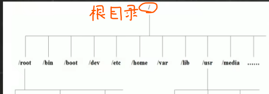

### 两条 Linux 世界观

1. **没有盘符**。Windows 是 C 盘 D 盘，Linux 是一棵树：`/` 是树根，U 盘插上来是"挂载"成树枝上的一个目录（`/media/xxx`），不是多一个盘。
2. **`/root ≠ /`**。`/` 是整棵树的根；`/root` 只是 root 用户的家目录。**新手最常混的一对，面试常挖这个坑。**

### /etc —— 运维之魂 ★★★

- 所有系统管理的配置文件和子目录
- **运维视角**：改 SSH（`/etc/ssh/sshd_config`）、配 Nginx、管用户（`/etc/passwd`、`/etc/shadow`）、配计划任务（`/etc/crontab`），全在这
- **安全视角**：渗透测试的头号目标。`/etc/passwd`（用户清单）和 `/etc/shadow`（密码哈希）是提权后的必看文件——面试常问"拿到 shell 后第一个看哪"
- **发行版差异**：CentOS 网络配置在 `/etc/sysconfig/network-scripts/`，Ubuntu 在 `/etc/netplan/`——讲发行版差异的好素材

### /var —— SOC 之眼 ★★★

- 存放经常变化的文件：日志、邮件、缓存
- **运维视角**：`/var/log/syslog`（Ubuntu）/ `/var/log/messages`（CentOS）、`/var/log/auth.log`（登录记录）、`/var/log/apache2/`（Web 日志）
- **安全视角**：查爆破攻击第一步就是 `grep "Failed password" /var/log/auth.log`

### /home ★★★ 与 /root ★★★

- `/home`：普通用户主目录，每人一个文件夹；**磁盘配额在这管**
- `/root`：管理员的家目录，**不在 /home 里**
- **安全视角**：排查入侵时翻可疑用户的家目录——`.bash_history`、`.ssh/authorized_keys` 是后门常客；拿到 root 后第一件事也常是翻 `/root/.bash_history`

### /usr 与 /usr/local ★★★

- `/usr`：apt/yum 装的软件基本都在这，类似 Windows 的 Program Files
- **`/usr/local`：手动编译安装的软件在这**——区别于包管理器：`apt/yum` 装的进 `/usr`，自己编译源码 / 手动解压 tar.gz 装的进 `/usr/local`
- 为什么要手动编译：**包管理器里的版本常常太旧**，生产环境需要新版本或自定义编译参数
- **安全视角**：`ls -lt /usr/local/bin | head` 看修改时间——攻击者编译恶意工具常落在这

> **记法：装东西看 /usr，改配置看 /etc——运维两大高频目录。**

---

## 4. 目录结构（二）：其余梯队

### /bin、/sbin ★★

- `/bin`：最常用命令（ls、cp、cat）。Ubuntu/Kali 上 `/bin → /usr/bin` 是**软链接**，`which ls` 可验证
- `/sbin`：s = Super user，管理员用的程序（shutdown、fdisk、iptables）
- **安全视角**：排查后门时对比 `/sbin` 下文件的修改时间——**攻击者替换系统命令是持久化手段之一**

### /selinux ★★（我的方向重点）

SELinux 是**强制访问控制（MAC）**子系统，控制"程序只能访问特定文件"。三种模式：

| 模式 | 行为 |
|---|---|
| **Enforcing** | 违规直接拦截并记日志 |
| **Permissive** | 不拦截，只记日志——排查"是不是 SELinux 搞的鬼"时用 |
| **Disabled** | 关闭 |

> **关键差异**：CentOS 默认装 SELinux；**Ubuntu/Kali 默认用 AppArmor，根本没有 `/selinux` 目录**——
> 我在 Ubuntu 上 `ls /` 找不到它不是装错了，是发行版安全模块不同。

> **为什么这对我的方向重要**：
> 1. 面试问"Linux 有哪些安全加固手段"，SELinux/AppArmor 是标准答案之一
> 2. 运维经典事故：服务起不来、文件明明 755 却读不了 → 十有八九是 SELinux 拦的
> 3. **MAC vs DAC**：`chmod` 那套是"主人自己定权限"（DAC），SELinux 是"系统强制规定程序能碰什么"（MAC），**哪怕程序被攻破也跑不出沙盒**——这就是纵深防御的落地

### /dev ★★ —— 设备与虚拟文件系统

- 类似 Windows 设备管理器，硬件都映射成文件（sda 磁盘、tty 终端、null、random）
- **安全视角**：`/dev/shm`（内存文件系统）是攻击者爱放的落地点——**重启即消失，取证时要抢在这之前看**

#### 小疑惑：为什么 /dev 里找不到 CPU？

CPU 不是"可读写的设备"，是计算单元，所以不进 `/dev`，而是以**信息文件**形式住在 `/proc`（`/proc/cpuinfo`）。

`/dev` 里其实**可以**有一个 `cpu` 目录（如 `/dev/cpu/0/msr`），但那是给底层调试读写 CPU 寄存器用的，需要手动加载 `msr` 内核模块才会出现——**平时没有是完全正常的。**

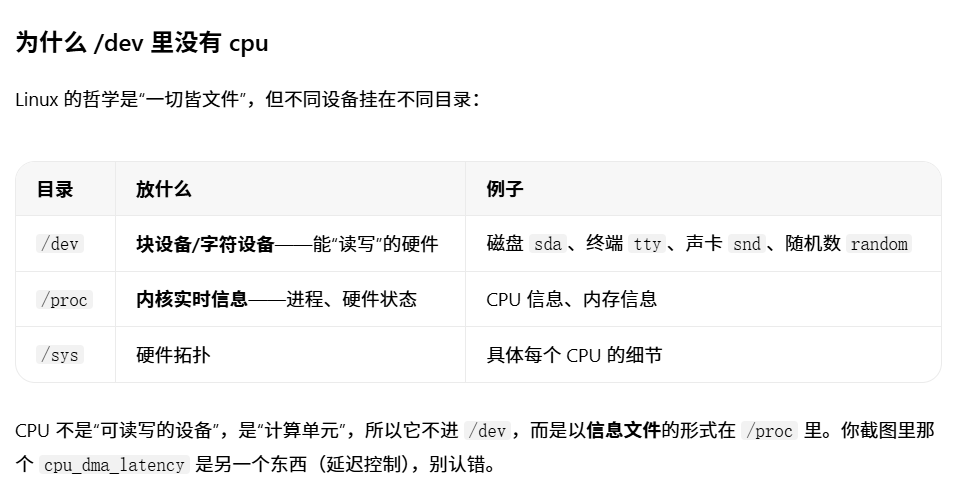

```bash
nproc                 # 直接告诉你几个核
lscpu                 # 详细型号、核数、架构
cat /proc/cpuinfo     # 最原始的完整信息（每个逻辑核一段）
```

### /proc 与 /sys ★★

- `/proc`：虚拟目录，是**系统内存的映射**。`cat /proc/cpuinfo`、`ps` 命令的本质就是读 `/proc`
- **安全视角**：**恶意软件藏身处**——`ls /proc` 里 PID 对不上进程列表 = 可能有内核级后门（rootkit 排查思路）
- 为什么"不能动"：它是内存映射不是真文件，改了没意义还可能搞崩
- `/sys`：2.6 内核后的 sysfs，把硬件和内核参数暴露出来，`/proc` 的现代化分身

### /media 与 /mnt ★

- `/media`：Linux 自动识别设备（U 盘、光驱）后自动挂载到这
- `/mnt`：让用户**临时挂载**别的文件系统
- **习惯：临时用 `/mnt`，长期用 `/etc/fstab` 配置**（详见 week02 §11）
- 差异：桌面版（Kali）插 U 盘自动挂到 `/media/用户名/`；**服务器版（我的 Ubuntu Server）要手动 mount**

### /opt ★、/tmp ★、/lib ★、/srv ★、/lost+found

| 目录 | 干什么 | 备注 |
|---|---|---|
| `/opt` | 额外安装的大型商业软件（Oracle、WebLogic） | 默认为空；Kali 上部分渗透工具也装这 |
| `/tmp` | 临时文件，重启可能清空，**所有用户可写（权限 1777）** | ⚠️ **攻击者经典落地目录，取证必查** |
| `/lib` | 系统开机最基本的动态链接库（类似 Windows 的 DLL） | 删了系统就废 |
| `/srv` | 服务启动后需要提取的数据 | 很多发行版是空的（Ubuntu 的 Nginx 页面在 `/var/www/html`） |
| `/lost+found` | 非法关机后的碎片文件 | ext4 自愈产物，每个挂载点独有一个 |

> **`/tmp` 为什么危险**：任何人可写 + 可执行位历史问题 = 提权跳板。
> 面试问"/tmp 为什么危险"，答这两点就够。

---

## 5. 三系统对照表：CentOS / Ubuntu / Kali

| 项目 | CentOS（教程演示） | Ubuntu（我的服务器） | Kali（我的攻击机） |
|---|---|---|---|
| 包管理 | yum / dnf、rpm | apt / dpkg | apt / dpkg |
| 系统日志 | /var/log/messages | /var/log/syslog | /var/log/syslog |
| 登录日志 | /var/log/secure | /var/log/auth.log | /var/log/auth.log |
| 网络配置 | /etc/sysconfig/network-scripts/ | /etc/netplan/ | /etc/NetworkManager/（桌面） |
| /bin 与 /usr/bin | CentOS 7 起合并 | 一直是软链接 | 一直是软链接 |
| U 盘自动挂载 | 桌面环境才有 | Server 无桌面需手动 | 有桌面自动挂 /media |
| 安全子系统 | **SELinux**（有 /selinux） | **AppArmor**（无） | **AppArmor**（无） |

### 对我方向最重要的三个

1. **`/etc`** —— 运维之魂。配 SSH、配 Nginx、改密码策略全在这
2. **`/var/log`** —— SOC 之眼。以后做蓝队每天泡的地方
3. **`/tmp`** —— 攻防双面人：任何用户都能写，攻击者爱在这放临时脚本，防守者爱在这翻可疑文件

**面试能讲的一句**

> Linux 一切皆文件，硬件也映射成文件（`/dev`），内核与进程信息是虚拟文件（`/proc`）。
> 排查问题的路径是：配置看 `/etc`、日志看 `/var/log`、落地痕迹看 `/tmp` 和 `/dev/shm`。

---

## 6. vim：三种模式与快捷键

> 远程服务器上没有 IDE，**以后改 SSH 配置 / Nginx 站点 / 安全规则，全靠 vim**——最高频的工具。

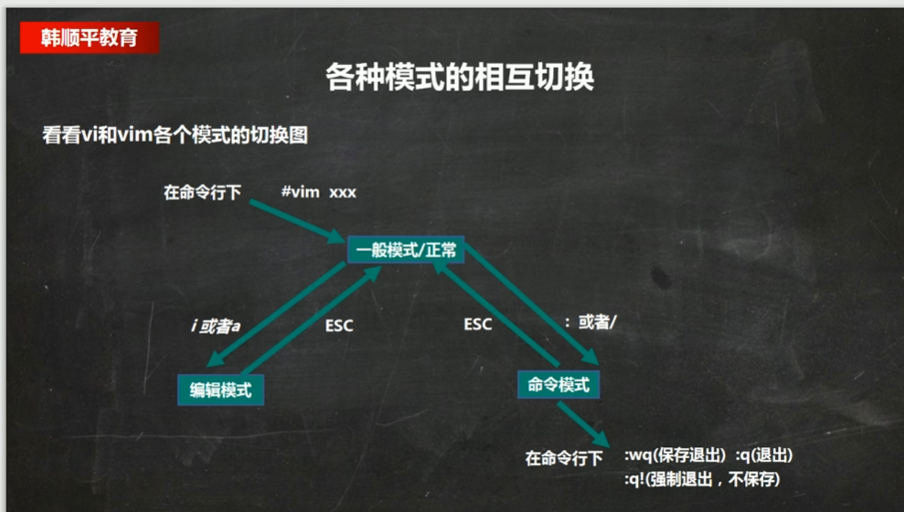

### 三种模式与怎么切

| 模式 | 怎么进 | 干什么 |
|---|---|---|
| **一般模式**（默认） | 打开 vim 就是 | 删除、复制、粘贴、跳转 |
| **插入模式** | 按 `i`（`I`/`a`/`A`/`o`/`O`/`r`/`R` 也行） | 编辑文本 |
| **命令行模式** | 一般模式下按 `:` 或 `/` | 保存、退出、查找、设行号 |

```bash
vim hello.java     # 打开
i                  # 进插入模式，开始编辑
<Esc>              # 退回一般模式
:wq                # 保存并退出（:q 无改动直接退 / :q! 有改动强制退）
```

### 常用快捷键

| # | 模式 | 快捷键 | 作用 |
|---|---|---|---|
| 1 | 一般 | `yy` / `5yy`，`p` 粘贴 | 复制当前行 / 向下 5 行 |
| 2 | 一般 | `dd` / `5dd` | 删除当前行 / 向下 5 行 |
| 3 | 命令行 | `/关键字` + Enter，`n` 下一个 | 向下查找 |
| 4 | 命令行 | `:set nu` / `:set nonu` | 显示 / 取消行号 |
| 5 | 一般 | `G` / `gg` | 跳到末行 / 首行 |
| 6 | 一般 | `u` | 撤销 |
| 7 | 一般 | `20` + `Shift+g` | 跳到第 20 行 |
| 8 | — | `:help` | 自查更多 |

> 教程里拿 `/etc/profile` 演示跳转，我在普通文件上验证过——**通用，不限于配置文件**。

**面试能讲的一句**

> vim 三模式：默认一般模式，`i` 进插入，`Esc` 回一般，`:wq` 保存退出。
> 改服务器配置的标准动作就是 `vim /etc/ssh/sshd_config` → `i` → 改 → `Esc` → `:wq`。

---

## 7. 文件目录指令：pwd / ls / cd / mkdir / rmdir / touch

### pwd

显示当前工作目录的**绝对路径**。


### ls

```bash
ls -a     # 显示所有文件，包括隐藏文件（Linux 下隐藏文件以 . 开头）
ls -l     # 以列表方式显示详细信息
ls -h     # 文件大小显示成人能读的单位（K / M / G）
ls -al    # 组合使用：ls -al /root
```

### cd

```bash
cd /root          # 绝对路径切换
cd ../../root     # 相对路径：从 /home/jack 出发，../进 /home，再 ../进 /，再进 root
cd ..             # 上一级目录
cd ~  或  cd      # 回到家目录
pwd               # 随时确认自己在哪
```

> **`cd` 后面必须有空格**。

### mkdir / rmdir / touch

```bash
mkdir /home/dog              # 建单级目录
mkdir -p /home/animal/tiger  # -p 建多级目录（不加 -p 父目录不存在就报错）
touch hello.txt              # 建空文件
rmdir 空目录                  # ⚠️ 只能删空目录
rm -rf 目录                  # 删非空目录
```

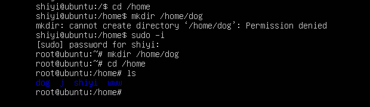

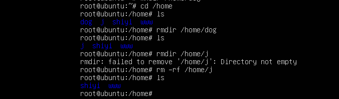

> 在 `/home`、`/etc` 等系统目录下建目录**需要 root 权限**（加 `sudo`）；**在自己的家目录里建不需要**。

> ⚠️ **`rm -rf` 是运维事故第一命令**——删之前先 `ls` 一遍确认路径，绝不在路径末尾多敲空格或 `/`。
> 生产环境"**先看后删**"这条纪律，面试可以直接讲。
> 更稳的做法：先 `mv` 到 `/tmp` 观察几天，确认没问题再清——**删除是不可逆的，移动是可逆的**。

---

## 8. 文件操作：cp / rm / mv / ln

### cp

```bash
cp hello.txt bbb/            # 拷文件到目录
cp -r /home/bbb /opt         # -r 递归复制整个文件夹
cp -a /home/bbb /opt/backup  # -a 归档：保留权限/属主/时间戳——备份必须用 -a，不是 -r
\cp -r /home/bbb /opt        # 强制覆盖不提示
```

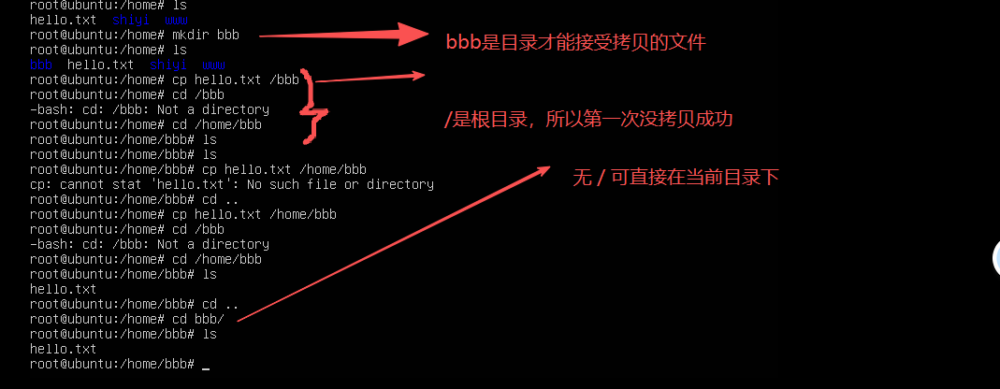


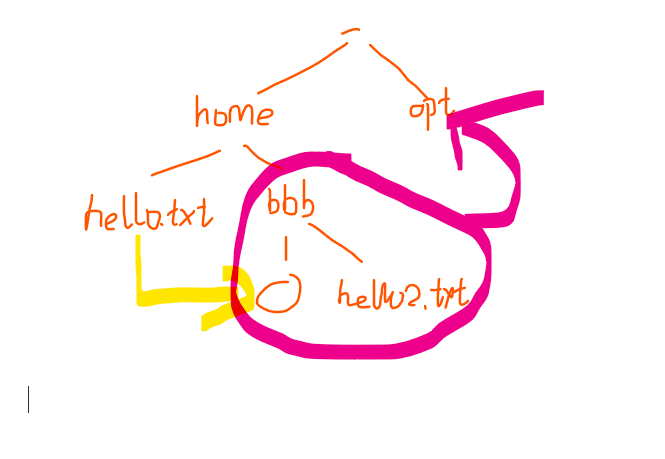

> **原理**：Ubuntu 里 `cp` 默认是 `cp -i`（交互询问）的**别名（alias）**，所以覆盖时会一直问 yes/no。
> `\cp` 开头的反斜杠 = "绕过别名、用原生命令"。
> **alias 能改变命令的默认行为**——这是运维常识，`alias` 命令本身能看到系统里所有别名。

### rm

```bash
rm /home/hello.txt      # 删文件
rm -r /home/bbb         # 递归删目录
rm -rf /home/bbb        # 强制删，不提示
```

### mv（移动 = 重命名，同一件事）

```bash
mv cat.txt pig.txt        # 重命名
mv pig.txt /root/         # 移动
mv pig.txt /root/cow.txt  # 移动并改名
mv bbb/ /home/            # 移动整个目录
```

### ln：软链接 vs 硬链接

```bash
ln -s /root /home/myroot  # 软链接（符号链接），类似 Windows 快捷方式
ln file1 file2            # 硬链接
rm /home/myroot           # 删软链接
```

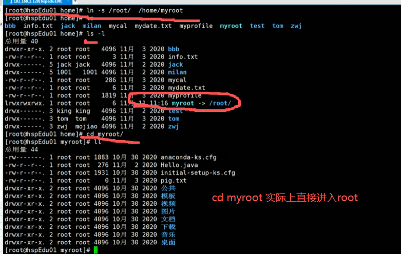

| | 软链接 `-s` | 硬链接 |
|---|---|---|
| 本质 | 存的是**指向原文件的路径** | 与原文件**同一个 inode** |
| 能否跨分区 | ✅ 可以 | ❌ 不行 |
| 能否对目录建 | ✅ 可以 | ❌ 不行 |
| 原文件删了 | 链接失效（红闪） | 文件还在（数据不丢） |

> ⚠️ **运维经典坑：删软链接时 `rm /home/myroot` 末尾千万别带 `/`**——
> `rm /home/myroot/` 删的是链接指向的真实目录里的内容，等于隔着快捷方式删本体。
> **软链接的删除永远只删"链接本身"。**

**面试能讲的一句**

> `cp -a` 才是备份（保留权限属主时间），`cp -r` 只是递归复制内容；
> 软链接存路径、可跨分区、可对目录，硬链接同 inode、不能跨分区也不能对目录——
> 面试问"硬链接和软链接的区别"就答这三点。

---

## 9. 查看文件：cat / more / less / head / tail

### cat

```bash
cat -n /etc/profile            # 带行号查看
cat -n /etc/profile | more     # 内容长时配合管道翻页
```

> `cat` 只能浏览，不能修改。

### more 与 less

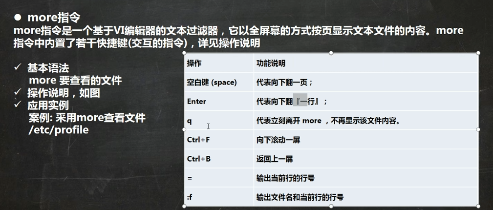

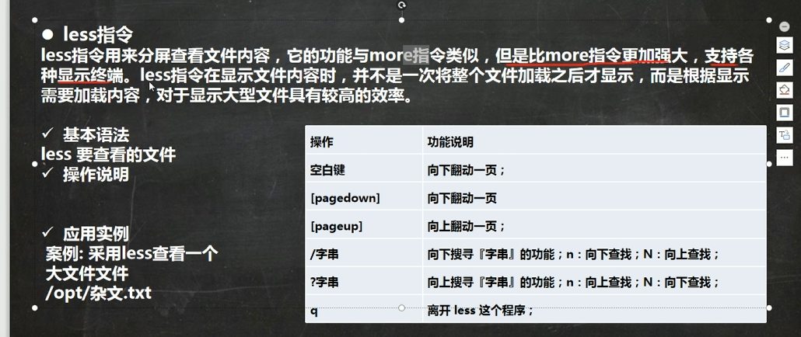

```bash
more /etc/profile     # 分页显示，只能往下翻
less /var/log/syslog  # 更强大：可上下翻、不全量加载
```

**less 的交互键**：`空格`/`f` 下翻一屏、`b` 上翻、`G` 到末尾、`g` 到开头、`/关键字` 搜索、`q` 退出。

> **`less` 比 `more` 强在哪**：支持上翻，且**不会一次性把整个文件读进内存**——
> 所以看几百 MB 的日志必须用 `less`，用 `more` 或 `cat` 会把内存吃满。

> 我踩过的一个误会：**文件内容不足一屏时，`more` 直接全部显示、不出现翻页提示**——
> 不是命令失效。这是分页逻辑的边界情况。

### head / tail

```bash
head -n 5 /etc/profile      # 看前 5 行（默认 10 行）
tail -n 5 /etc/profile      # 看最后 5 行
tail -f mydate.txt          # 实时追踪文件更新
```

> 🔒 **`tail -f` 是我这个方向最重要的一行命令**：
> `tail -f /var/log/auth.log` = 实时盯着 SSH 登录失败记录滚动刷新——
> 这就是以后 SOC 值班每天干的事的雏形。
> 配合 `grep "Failed password" /var/log/auth.log` 就是日志巡检脚本的骨架。

### 补充：file

```bash
file 文件名       # 看文件的真实类型（ELF 可执行？脚本？文本？）
```

> **安全方向常用**：下载来的可疑文件先 `file` 一下，看它到底是二进制木马还是伪装成图片的脚本。
> 文件扩展名是可以改的，`file` 读的是文件头，骗不了它。

**面试能讲的一句**

> 看大文件用 `less` 不用 `cat`（不全量加载、可上翻）；盯日志用 `tail -f`；
> 判断文件真实类型用 `file`——扩展名可以改，文件头骗不了人。

---

## 10. 重定向、echo 与 history

### 重定向

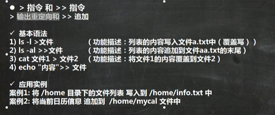

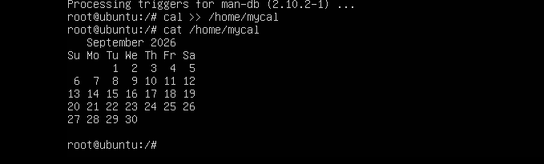

```bash
ls -l /home > /home/info.txt   # > 覆盖（文件不存在会自动创建）
cal >> /home/mycal             # >> 追加
```

> **目录不存在不会自动创建**——重定向只能新建文件，不能新建目录。

### echo

```bash
echo $HOSTNAME      # 输出环境变量
echo "hello,world"  # 输出字符串
```

### history

```bash
history          # 看全部历史命令
history 10       # 看最近 10 条
!5               # 直接重跑第 5 条
```

> ⚠️ **安全视角**：`history` 会**明文记录你敲过的所有命令**，包括命令里带的密码。
> - `history -c` 清当前会话记录
> - `HISTCONTROL=ignorespace`：命令前加空格就不进历史
> - `~/.bash_history` 是**取证和攻击面双向的重点文件**（见 §3 的 /home、/root 两节）

**面试能讲的一句**

> `>` 覆盖、`>>` 追加；重定向只能自动建文件、不能建目录。
> `history` 会明文记录命令（含密码），敏感操作前用 `HISTCONTROL=ignorespace` 规避。

---

## 11. 时间日期：date / cal

```bash
date                        # 显示当前时间
date "+%Y-%m-%d"            # 只显示年月日
date "+%Y-%m-%d %H:%M:%S"   # 完整时间戳
date -s "2020-11-03 20:02:10"   # 设置系统时间（需 root）
cal                         # 显示本月日历
cal 2020                    # 显示 2020 年日历
```

> ⚠️ `date` 和格式化字符串**之间必须有空格**：`date "+%Y-%m-%d"`，写成 `date"+%Y-%m-%d"` 会报错。
> 格式符大小写不能错：`%Y` 四位年、`%m` 月、`%d` 日、`%H` 时、`%M` 分、`%S` 秒。

> Ubuntu Server 上 `cal` 属于 `ncal` 包，没有的话 `sudo apt install ncal`。

---

## 12. 帮助指令：man / help

```bash
man ls        # 查命令手册
man 5 passwd  # ← 数字是"章节号"，5 = 配置文件格式
help cd       # 查 shell 内置命令（cd 这类没有独立 man 页的）
```

> **`man` 后面的数字是什么意思**（面试会问）：
> `1` 用户命令、`2` 系统调用、`3` 库函数、`5` **配置文件格式**、`8` 管理员命令。
> 例：`man 1 passwd` 查的是 passwd 命令，`man 5 passwd` 查的是 `/etc/passwd` 文件格式。

> 在 Linux 下，隐藏文件以 `.` 开头。忘记命令随时可以 `man`，查不到再搜索。

---

## 13. 关机重启与登录注销

```bash
shutdown -h now    # 立即关机
shutdown -h 1      # 1 分钟后关机
shutdown -r now    # 立即重启
halt               # 关机
reboot             # 重启
sync               # 把内存数据同步到磁盘
```

> 不管重启还是关机，**先跑 `sync`** 把内存数据落盘。
> 现在的 `shutdown/reboot/halt` 已经内置了 sync，但手动再跑一次是老运维的习惯。

### 登录与注销

```bash
su - root     # 切到 root（⚠️ - 和 root 之间有空格，写成 su -root 是错的）
exit          # 退回上一个用户（logout 同效）
logout        # 注销
```

> 登录时**尽量少用 root**——权限太大，误操作代价高。用普通用户登录后再 `su - root` 切换。
> **root 命令统一用 `sudo` 更符合最小权限原则**（详见 week02 §6）。

> `logout` 在图形运行级别无效，在命令行级别才有效。
> 速记：**3 = 黑框（命令行），5 = 桌面（GUI）**——我的 Ubuntu Server 就在命令行级别。

---

## 14. 用户与组（命令视角）

> **岗位视角**：账号开通 / 权限变更 / 离职销户是运维最高频的工单类型，也是安全的根基——
> `/etc/shadow` 只允许 root 读，就是"权限最小化"的教科书案例。
> **等保 2.0 的"身份鉴别"控制项，审的就是这套用户体系**：账号唯一性、密码复杂度、
> 登录失败处理、定期更换——前三条看 `/etc/login.defs` 和 PAM，最后一条用 `chage -l`。

```bash
sudo -i                      # 用户管理需要 root 权限
useradd -m jack              # 建用户（-m 建家目录；Ubuntu 默认不建，统一加 -m）
useradd -d /home/test king   # 指定家目录
passwd jack                  # 设密码（不指定用户名则改当前用户）
userdel j                    # 删用户但保留家目录（生产环境默认选这个）
userdel -r j                 # 连家目录一起删（⚠️ 不可恢复）
id jack                      # 查 uid/gid/所属组
whoami / who am i            # 当前用户 / 最初登录的用户

groupadd Jack                # 建组
groupdel Jack                # 删组
useradd -m -g Jack jack      # 建用户时直接指定组
usermod -g 组名 用户名        # 改用户所属组
```

> **没设密码的用户无法登录**，也切不过去——这是新手最常卡住的地方。
> 新建用户时**一定要记得 `passwd`**。

打开 `/etc/passwd` 看一眼（下面是**本机实测输出**，每行 7 个字段：用户名:口令占位:UID:GID:注释:家目录:登录Shell）：

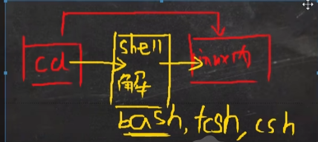

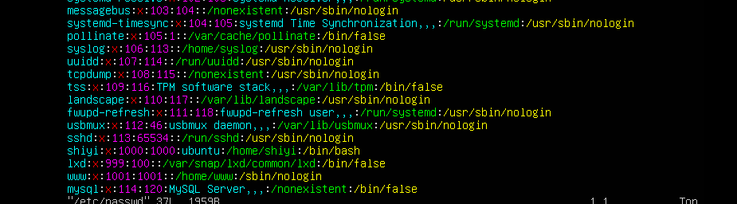

```bash
ls -l /bin/*sh      # 看系统里有哪些 shell 可用
```

> **安全注解**：口令位恒为 `x`——真实哈希在 `/etc/shadow`（仅 root 可读）。
> **明文口令绝不放 passwd，因为 passwd 必须全用户可读**——这就是最小权限设计。

> **`/etc/passwd`、`/etc/shadow`、`/etc/group` 三个文件的完整字段解读、
> `sudo` 授权机制（`usermod -aG sudo`）、`chage` 密码策略、SUID 特殊权限
> → 详见 week02 §6、§7**，那里是按"面试会被问到什么"展开的，这里不重复。

---

## 15. 远控与重置 root 密码

### 远程控制（不装第三方工具）

**结论：不装 Xshell / Xftp / MobaXterm——Windows 自带 ssh / scp 全覆盖。**

| 场景 | 命令 |
|---|---|
| 远程登录 | `ssh 用户名@192.168.174.128` |
| 传文件上去 | `scp D:\文件.txt 用户名@IP:/home/用户名/` |
| 从服务器拿下来 | `scp 用户名@IP:/var/log/xxx.log D:\` |

> **实操状态**：`ssh` 是天天在用的（本笔记里所有终端操作都是主机 SSH 连进 Ubuntu 完成的）；
> **`scp` 那两条目前只记用法，本机还没传过**——下一步用它把 `/var/log/auth.log` 拉下来做登录审计时补记。
> 按本笔记的规则，"没跑过"必须写清楚，不能混在"实测"里。

### 重置 root 密码（Ubuntu / Kali）— 已在 VMware 本机实测走通

> **岗位视角**：这是**安全视角的必考题——能物理接触机器 = 能重置 root 密码**。
> 所以生产环境不靠 root 密码本身防入侵，靠的是 **GRUB 加密、磁盘加密和机房门禁**。
> 面试能讲清"物理访问即管理员权限"这个链条，就是内行信号。

1. 重启，开机时长按 **Shift**（UEFI 下按 Esc）调出 GRUB 菜单
2. 选中 Ubuntu，按 **`e`** 进入编辑（要在 GRUB 超时前按）
3. 找到 `linux` 行：把 `ro` 改成 `rw`，行尾加 `init=/bin/bash`
4. `Ctrl+X` 或 `F10` 启动进 shell → `mount -o remount,rw /` → `passwd root` → `exec /sbin/init`

> Ubuntu 默认 root 账户是**锁定状态**，平时用 sudo；这个流程同样能重置普通用户密码。
> 小提示：改密码时数字小键盘（NumLock）可能没开，用主键盘区的数字键。

> **运行级别 / systemd target 的完整说明见 week03 §10**——
> 那里讲了 `systemctl get-default` / `isolate` / `set-default` 三板斧，以及为什么 `init 3` 已弃用。

---

## 附：本笔记的统一规则

1. 正文只记**我在 Ubuntu 上亲手执行过的命令**；CentOS / 教程内容一律压成「> 对照标注」一行或对照表。
2. **纯查询类、输出一眼看明白的命令不贴输出**——记命令和用法即可；
   需要解读的输出（目录结构、重定向、权限位）才贴。
3. 需要 root 权限的命令统一写 `sudo`，不直接切 root 操作。
4. 每节末尾留一句**面试能讲的话**——笔记的目的是攒讲得出来的东西，不是攒命令清单。
5. 动 `/etc` 下的配置、删除文件、改网络之前：**先备份 / 先拍快照**，改完立刻验证。
6. **跨周不重复展开**：本周接触到的用户体系、运行级别等，只在对应周的深度笔记里展开一次，
   这里保留"第一次接触时的理解"+ 指针，保持学习脉络但不啰嗦。
