# week02 权限与用户管理

> **我的环境**：Ubuntu Server（VMware 虚拟机，NAT 模式，IP `192.168.174.128`）
> 另一台：Kali（VMware，同为 Debian 家族，命令通用）
> 发行版/内核：Ubuntu 22.04.5 LTS / 5.15.0-198-generic
>
> **关于教程**：主教程为 CentOS 7 环境（韩顺平）。
> 因此本笔记**正文只保留我在 Ubuntu 上亲手执行过的命令**，
> CentOS 内容一律降级为「对照标注」一行——这是本笔记的统一规则。
>
> **选记原则**：命令我都在本机跑过，但**纯查询类、输出一眼看明白的不贴输出**——
> 笔记记的是"我理解了什么"，不是终端日志。
>
> 文中配图均为本人学习过程中自己截的图（含自己敲命令的终端输出）。

## 目录

- [1. 查找指令：find / locate / grep](#1-查找指令find--locate--grep)
- [2. 压缩与解压：gzip / zip / tar](#2-压缩与解压gzip--zip--tar)
- [3. 用户与组](#3-用户与组)
- [4. 权限：rwx 与数字法](#4-权限rwx-与数字法)
- [5. 改权限与归属：chmod / chown / chgrp](#5-改权限与归属chmod--chown--chgrp)
- [6. sudo 与用户认证文件](#6-sudo-与用户认证文件)
- [7. 特殊权限：SUID / SGID / Sticky](#7-特殊权限suid--sgid--sticky)
- [8. 实战：多用户协作与权限](#8-实战多用户协作与权限)
- [9. 周期任务：crontab](#9-周期任务crontab)
- [10. 一次性任务：at](#10-一次性任务at)
- [11. 磁盘分区与挂载](#11-磁盘分区与挂载)
- [12. 磁盘使用查询：df / du](#12-磁盘使用查询df--du)

---

## 1. 查找指令：find / locate / grep

### 1.1 find —— 按属性实时查找

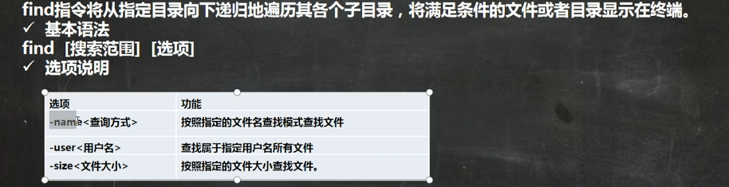

```bash
find /home -name hello.txt      # 按文件名
find /opt  -user nobody         # 按拥有者
find /     -size +200M          # 按大小（+n 大于 / -n 小于 / n 等于，单位 k M G）
find /etc -type f -mtime -1     # 按类型 + 修改时间（1 天内改过的普通文件）
```

> **找不到就不输出**，find 不报错、静默退出——第一次用容易以为命令坏了。

### 1.2 locate —— 查数据库，快但不实时

`locate` 不遍历磁盘，它查的是事先建好的文件路径数据库（`/var/lib/mlocate`），所以**快，但新建的文件查不到**。

```bash
sudo updatedb          # 第一次用之前必须建库；之后新建的文件也要 update 才查得到
locate hello.txt
which ls              # 顺带：which 查"命令本身"在哪个目录
```

### 1.3 grep 与管道 `|`

管道 = 把前一个命令的输出，交给后一个命令处理。

```bash
grep -n "yes" /home/hello.txt        # -n 显示行号，-i 忽略大小写
cat -n /home/hello.txt | grep "yes"  # 等价写法：先编号再过滤
```

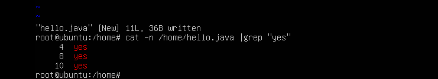

### 三个查找指令对比

| 指令 | 搜什么 | 工作方式 | 适用场景 |
|---|---|---|---|
| `find` | 文件/目录的**属性**（名、拥有者、大小、权限） | 实时遍历磁盘 | 精确查文件、按多条件过滤 |
| `locate` | 文件路径 | 查 `/var/lib/mlocate` 数据库 | 知道名字找位置，快，但要先 `updatedb` |
| `grep` | 文件**内容** | 文本匹配 | 在文件里找关键字，常和 `\|` 联用 |

**面试能讲的一句**

> 找文件用 find（实时、可按属性过滤），找路径用 locate（查库，快），找内容用 grep。
> 三者的区别在于**搜的对象不同**——属性、路径、内容。

---

## 2. 压缩与解压：gzip / zip / tar

### 2.1 gzip / gunzip —— 压单个文件

```bash
gzip /home/hello.txt          # 压缩 → hello.txt.gz（源文件消失）
gunzip /home/hello.txt.gz     # 解压
```

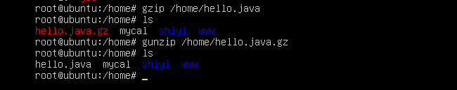

### 2.2 zip / unzip —— 跨平台打包

```bash
zip -r myhome.zip /home/          # -r 递归，压目录必须加（最常忘的就是它）
unzip -d /opt/tmp myhome.zip     # -d 指定解压到哪（目录不存在会报错，先 mkdir）
```

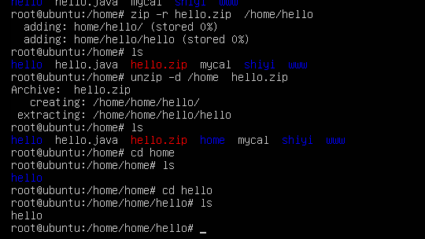

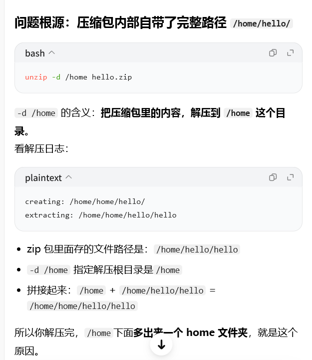

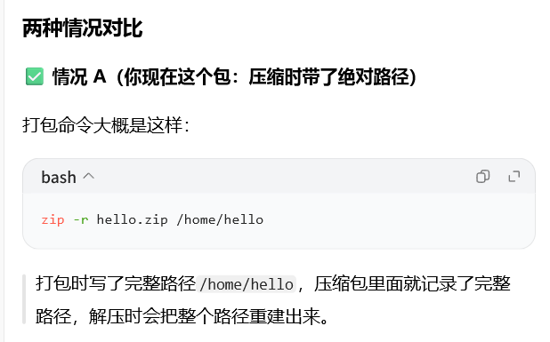

### 2.3 tar —— Linux 上最常用

```bash
tar -zcvf pc.tar.gz /home/pig.txt /home/cat.txt   # 打包并压缩多个文件
tar -zxvf pc.tar.gz                               # 解包到当前目录
tar -zxvf myhome.tar.gz -C /opt/tmp2              # -C 解到指定目录（目录要先 mkdir）
```

**tar 选项**（注意大小写是两个不同的选项，最易混）：

| 选项 | 含义 |
|---|---|
| `-c` | **create，打包**（小写） |
| `-x` | 解包 |
| `-z` | 打包同时用 gzip 压缩 |
| `-v` | 显示详细过程 |
| `-f` | 指定文件名（**必须放在最后，紧跟文件名**） |
| `-C` | **解包时指定目标目录**（大写，和 `-c` 完全不同） |

> ⚠️ 我原来把 `-C` 记成"产生 .tar 打包文件"，**是错的**——那是 `-c`。
> `-C` 只在**解包**时用，指"解到哪个目录"。

### 三种压缩对比

| 指令 | 压缩对象 | 产物后缀 | 典型用途 |
|---|---|---|---|
| `gzip/gunzip` | 单个文件 | `.gz` | 压单个大文件，**源文件会消失** |
| `zip/unzip` | 文件或目录（`-r` 递归） | `.zip` | 跨平台打包（Windows 也能解） |
| `tar` | 文件或目录 | `.tar.gz` / `.tgz` | **Linux 项目打包发布，最常用** |

**面试能讲的一句**

> 生产上统一用 `tar -zcvf` / `tar -zxvf`；跟 Windows 交互用 zip。
> `-c` 打包、`-C` 指定解压目录，大小写别混。

---

## 3. 用户与组

Linux 中**每个用户必须属于一个组**；每个文件有三个归属概念：

- **所有者（user）**：一般是文件的创建者
- **所在组（group）**：创建者所在的组
- **其他组（others）**：除上面两类之外的所有人

```bash
groupadd monster                 # 建组
useradd -m -g monster fox       # 建用户并指定组（-m 同时建家目录，Ubuntu 上不加会没家目录）
passwd fox                      # 设密码（不设的话，普通用户 su 切不过去）
id fox                           # 看 uid/gid/属于哪些组
usermod -g police xh            # 改用户的主组（-g 别漏）
usermod -d /home/newhome xh     # 改用户登录的初始目录（用户要有进入该目录的权限）
cat /etc/group | grep police    # 确认组在不在
```

> 改组之前先 `id 用户名` 看现在在哪，改完再 `id` 一次确认——这是我自己养成的两步验证。

### 查看与修改归属

```bash
ls -l                    # 看所有者与所在组
chown tom apple.txt       # 改所有者
chgrp fruit orange.txt    # 改所在组
chown tom:tom /home/kkk   # 一次改所有者和组
chown -R tom:tom /home/kkk   # -R 递归：目录下所有文件都改（改目录必须加）
```

> ⚠️ 上面这些**都需要 root 权限**，实际执行时前面加 `sudo`。

**面试能讲的一句**

> `chown` 改所有者、`chgrp` 改所属组、`chmod` 改权限——三个命令各管一件事。
> 改目录一定要带 `-R`，否则只有目录本身变了、里面的文件没变。

---

## 4. 权限：rwx 与数字法

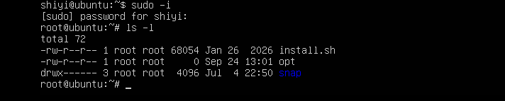

`ls -l` 的输出：

```text
-rwxrw-r-- 1 root root 1213 Feb 2 09:39 abc
 └┬┘└┬┘└┬┘
  │  │  └── 第 7-9 位：其他用户 others
  │  └───── 第 4-6 位：所属组 group
  └──────── 第 1-3 位：所有者 user
```

第 0 位是文件类型：`-` 普通文件、`d` 目录、`l` 软链接、`c` 字符设备（键盘鼠标）、`b` 块设备（硬盘）。

### rwx 作用在文件 vs 目录（**区别很大，必考**）

| 权限 | 作用在**文件** | 作用在**目录** |
|---|---|---|
| `r` | 可以读取内容 | 可以 `ls` 列出目录内容 |
| `w` | 可以修改内容（**不代表能删除该文件**） | 可以在目录内**创建 / 删除 / 重命名** |
| `x` | 可以执行 | 可以 `cd` **进入**该目录 |

> ⚠️ **删除一个文件的前提，是对它所在的目录有 `w` 权限**，跟文件本身的权限无关。
> 这是最容易答错的权限题。

### 数字法

`r=4  w=2  x=1`，三位相加：`rwx=7`、`r-x=5`、`rw-=6`。

```bash
chmod 755 /home/abc.txt    # rwxr-xr-x
chmod 640 jack.txt         # rw-r-----（所有者读写、同组只读、其他无权限）
```

### umask：新建文件为什么是 644？

```bash
umask          # 我的机器输出 0022
```

- 文件默认满权限 666，目录 777
- 实际权限 = 满权限 − umask
- `umask 022` → 文件 `644`、目录 `755`

> 想让新建文件对同组可写，改 umask 或 `chmod g+w`；**不建议把 umask 改成 000**，等于默认对所有人都开放。

---

## 5. 改权限与归属：chmod / chown / chgrp

### 符号法：`u` / `g` / `o` / `a`

`u` 所有者、`g` 所在组、`o` 其他人、`a` 全部（ugo 三者）。

```bash
chmod u=rwx,g=rx,o=rx abc
chmod u-x,g+w abc
chmod a+r abc
```

> ⚠️ **`=` 是赋值覆盖，不是追加**。`chmod a=r abc` 会把 ugo 三组**全部**设为只读，
> 即使原来有 `w` 也会被抹掉。我在这上面吃过亏（当时以为只是"加一个读权限"）。

### 数字法

```bash
chmod 751 abc      # 等价于 chmod u=rwx,g=rx,o=x abc
```

---

## 6. sudo 与用户认证文件

> 这一节是"用户管理"里真正被问到的部分，也是我最初漏掉的部分。

### 6.1 提权：sudo，而不是直接用 root

```bash
sudo <命令>              # 临时以 root 身份执行
sudo -l                  # 看"我被允许执行哪些 sudo 命令"
sudo -i                  # 切到 root 的登录 shell（有完整 root 环境变量）
```

**给一个普通用户管理员权限**（Ubuntu 的做法）：

```bash
sudo usermod -aG sudo 用户名       # -aG = append to Group，必须带 -a，否则会覆盖掉原有附加组
```

> ⚠️ `-aG` 的 `-a`（append）**不能省**。只写 `-G` 会把用户从其他附加组里踢出去，
> 这是 `usermod` 最经典的坑。

改 `/etc/sudoers` 时**必须**用：

```bash
sudo visudo        # 它会做语法检查；直接 vim /etc/sudoers 写错会导致所有人用不了 sudo
```

> CentOS 上管理员组叫 `wheel`，Ubuntu 上叫 `sudo`——这是两套发行版的一个常见差异。

### 6.2 三个认证文件

| 文件 | 作用 | 谁能读 |
|---|---|---|
| `/etc/passwd` | 用户账号信息 | 所有人 |
| `/etc/shadow` | **密码哈希**与密码策略 | 只有 root |
| `/etc/group` | 组信息 | 所有人 |

`/etc/passwd` 每行 7 个字段：

```text
fox:x:1001:1001::/home/fox:/bin/bash
 │   │   │    │  │    │        └── 7. 登录 shell（/usr/sbin/nologin = 禁止登录）
 │   │   │    │  │    └─────────── 6. 家目录
 │   │   │    │  └──────────────── 5. 备注（GECOS，通常空）
 │   │   │    └─────────────────── 4. GID 主组号
 │   │   └──────────────────────── 3. UID
 │   └──────────────────────────── 2. 密码占位符（x = 真密码在 shadow 里）
 └──────────────────────────────── 1. 用户名
```

`/etc/shadow` 第二列是关键：

- `x` 出现在 passwd 里 → 表示**密码在 shadow 中**（不是密码本身）
- shadow 里是 `$6$...` → SHA-512 哈希（`$1$`=MD5，`$5$`=SHA-256）
- **`!!` 或 `*`** → 账号**被锁定**，不能密码登录
- **空** → 无密码，可直接登录（**高危，等保必查项**）

```bash
sudo grep -E '^[^:]+:[^!*]' /etc/shadow    # 查有没有空密码/异常账号
```

### 6.3 密码策略与登录审计

```bash
sudo chage -l 用户名          # 看密码有效期：上次修改、过期时间、是否强制修改
sudo chage -M 90 用户名       # 设密码 90 天过期
```

> `chage` 是**等保测评里"口令定期更换"那条的直接落地命令**，
> 测评时看的就是 `chage -l` 的输出。

```bash
last                 # 历史登录记录（谁、什么时候、从哪个 IP）
lastlog               # 每个用户的最后一次登录时间
w                     # 当前谁在线、在干嘛
who                   # 当前登录了哪些用户
```

> 排查"这台机有没有被别人登过"，第一件事就是 `last` + `lastb`（失败登录）。

**面试能讲的一句**

> 给权限用 sudo 组，不用共享 root 密码；
> 密码哈希在 `/etc/shadow`，只有 root 能读，`!!` 表示锁定、空密码是高危；
> `chage -l` 查密码有效期，`last` / `lastlog` 查登录历史——这是安全审计的起点。

---

## 7. 特殊权限：SUID / SGID / Sticky

普通权限之外还有三位，加在 `rwx` 前面（数字法的第 4 位）：

| 名称 | 数字 | 作用在哪 | 效果 |
|---|---|---|---|
| **SUID** | 4 | 可执行文件 | 执行时**临时获得文件所有者的身份**（`passwd` 就是靠它让普通用户改自己的密码） |
| **SGID** | 2 | 可执行文件 / 目录 | 目录上：新建文件**自动继承目录的组** |
| **Sticky** | 1 | 目录 | 只有文件所有者能删自己的文件（`/tmp` 就是） |

```bash
ls -l /usr/bin/passwd          # 看到 -rwsr-xr-x，s 就是 SUID
chmod 4755 file                 # 设 SUID
chmod 2755 dir                  # 设 SGID
chmod 1777 /tmp                 # 设 Sticky

find / -perm -4000 -type f 2>/dev/null     # 找出系统里所有带 SUID 的文件
```

> ⚠️ **`find / -perm -4000` 是安全方向的常用动作**：SUID 程序会以 root 身份运行，
> 一个可写的、或来路不明的 SUID 文件就是**提权入口**。
> 我在安全方向上的理解是：权限审计不只看 `rwx`，**特殊权限位才是提权的高发区**。

**面试能讲的一句**

> `ls -l` 里出现 `s`（如 `-rwsr-xr-x`）就是 SUID，执行者会临时拿到文件所有者的权限；
> `passwd` 靠它工作，但也正因如此，**排查提权风险要 `find / -perm -4000` 过一遍**。

---

## 8. 实战：多用户协作与权限

> 以下两个案例我都在 Ubuntu Server 上完整做过，包括中间做错的地方。

### 8.1 案例一：警匪（police / bandit）

```bash
# root
groupadd police && groupadd bandit
useradd -m -g police jack && useradd -m -g police jerry
useradd -m -g bandit xh   && useradd -m -g bandit xq
passwd jack && passwd jerry && passwd xh && passwd xq
```

jack 建文件，自己读写、同组读、其他组无权限：

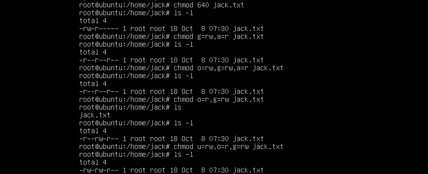

```bash
su - jack
cd ~ && vim jack.txt
chmod 640 jack.txt          # rw-r-----
chmod g=rw,o=r jack.txt     # 改成同组可读写、其他组只读
```

把 xh 拉进警察组，再测 xh / xq 的访问差异：

```bash
sudo usermod -g police xh
```

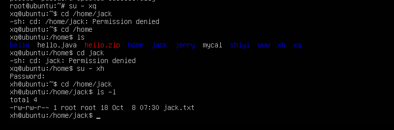

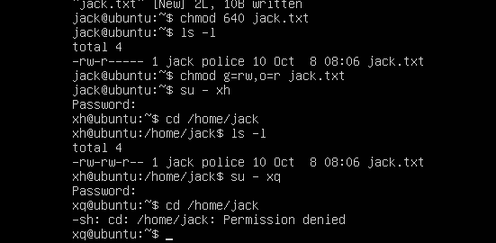

为什么 xq 进不去：

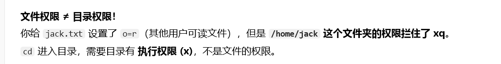

**结论：要对目录内的文件做操作，先得有对那个目录的相应权限（`x` 进入、`w` 增删）。**
文件权限和目录权限是两层，缺哪一层都进不去。

### 8.2 案例二：西游记（sx / yg）

```bash
# root
groupadd sx && groupadd yg
useradd -m ts && useradd -m ss && useradd -m wk && useradd -m bj
passwd ts && passwd ss && passwd wk && passwd bj
usermod -g sx ts && usermod -g sx ss
usermod -g yg wk && usermod -g yg bj

# 悟空建文件，给八戒读写
su - wk
vim monkey.java            # 内容：i am a monkey
chmod g+w monkey.java
chmod g+rwx /home/wk       # ← 关键：还要给八戒进入/home/wk 目录的权限

# 八戒进去改
su - bj
cd /home/wk && vim monkey.java

# 沙僧改投妖怪组后也能改
su - root
usermod -g yg ss
```

目录 rwx 的细节测试：

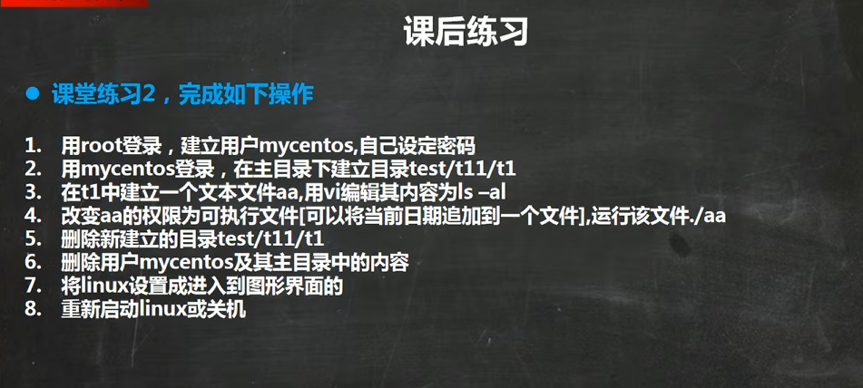

- `x`：能 `cd` 进去
- `r`：能 `ls` 出内容
- `w`：能在里面创建/删除文件

### 8.3 我在这两个案例里踩的坑

1. **`cd /home/jack` 里创建文件 ≠ 登录 jack 创建文件**。
   前者是 `root:root`，后者才是 `jack:police`——当时卡在这里半天。
2. **`chmod a=r` 是赋值不是追加**，把 ugo 三组全设成只读了。
3. **改文件权限不够，还得改目录权限**。八戒进不去 `/home/wk` 不是文件的问题，是目录没给 `x`。
4. **`usermod` 改组忘了写 `-g`**，命令不报错但什么都没改。
5. **新建用户不设密码，`su` 切不过去**（root 可以，普通用户不行）。
6. 提示符 `xh@ubuntu:jack$` 里，`xh` 是**用户**，`jack` 是**当前目录**——刚开始看反过。

### 8.4 顺带：Ubuntu 纯命令行开多个终端

```bash
Ctrl+Alt+F2 / F3          # 切虚拟控制台 tty2 / tty3
sudo apt install tmux     # 或装 tmux，一个连接里分屏
tmux                      # Ctrl+B 后按 % 左右分屏，Ctrl+B 后按 o 切换
```

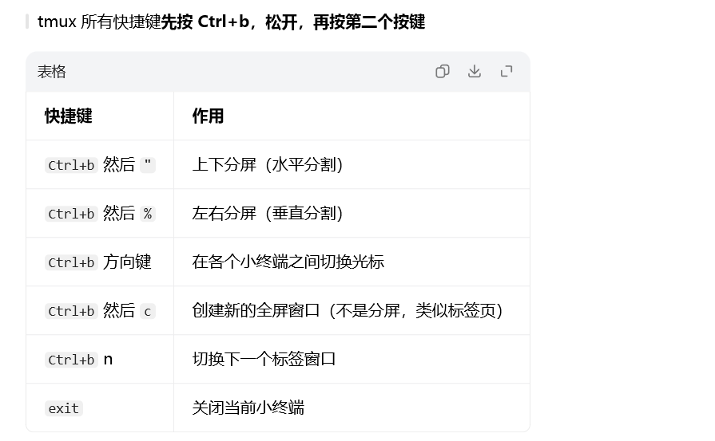

**面试能讲的一句**

> 目录权限和文件权限是两层：进目录要 `x`，在里面增删要 `w`，能不能读写文件看文件自己的 `rwx`。
> 排查"某个用户访问不了"，要**从目录往下逐层查**，只看文件权限是不够的。

---

## 9. 周期任务：crontab

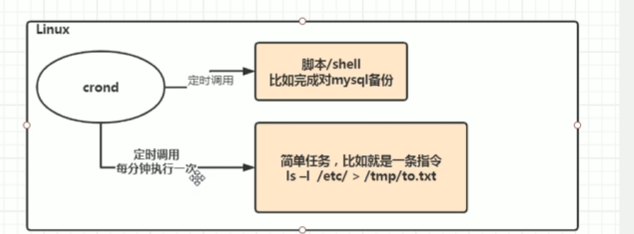

### 基本用法

```bash
crontab -e        # 编辑（首次会让选编辑器，选 nano 最省事）
crontab -l        # 列出当前用户的任务
crontab -r        # 删除当前用户的所有任务（慎用，没有二次确认）
```

### 时间规则

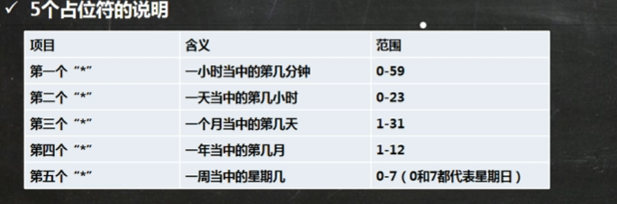

| 符号 | 含义 | 例子 |
|---|---|---|
| `*` | 任意时间 | `* * * * *` 每分钟 |
| `,` | 不连续的时间点 | `0 8,12,16 * * *` 每天 8/12/16 点 |
| `-` | 连续范围 | `0 5 * * 1-6` 周一到周六凌晨 5 点 |
| `*/n` | 每隔 n 单位 | `*/10 * * * *` 每 10 分钟 |

**五个字段顺序：分 时 日 月 星期**，星号之间**必须有空格**。

> 星期几和几号**不要同时指定**，容易变成"或"关系导致执行时间超出预期。

### 实战

```bash
*/1 * * * * date >> /tmp/mydate                  # 每分钟追加当前日期
# 跑脚本：先写脚本 → 加执行权限 → 再交给 cron
chmod u+x /home/shiyi/my.sh
*/1 * * * * /home/shiyi/my.sh
0 2 * * * mysqldump -u root -p testdb > /home/db.bak   # 每天凌晨 2 点备份
```

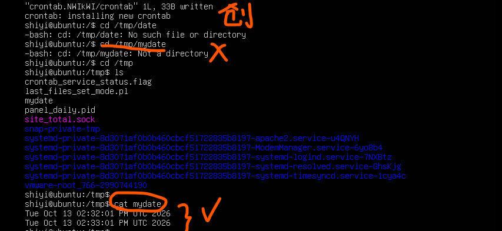

> ⚠️ **别把密码明文写进 crontab**（教程示例里那种 `-proot` 的写法）。
> 正确做法是交互输入，或写进 `~/.my.cnf` 并把权限设为 `600`。
> crontab 文件本身是能被同机其他用户读到的。

### cron 的五个坑（面试高频："脚本手动能跑，cron 里不执行"）

1. **环境变量不同**——cron 的 `PATH` 很窄，脚本里要用**命令的绝对路径**（`/usr/bin/python3` 而不是 `python3`）
2. **相对路径失效**——cron 的工作目录不是你的家目录，脚本里写绝对路径
3. **`%` 要转义**——cron 里 `%` 是特殊字符，需写成 `\%`
4. **输出默认丢弃**——加上 `>> /var/log/mycron.log 2>&1` 才有据可查
5. **文件会自动新建，但目录不会**——目录不存在就静默失败

### 服务控制（Ubuntu 是 `cron`，不是 `crond`）

```bash
sudo systemctl status cron        # 看运行状态
sudo systemctl restart cron       # 重启
sudo systemctl enable cron        # 开机自启
```

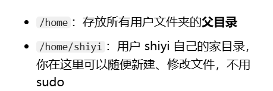

> `crontab -e` 保存后**自动生效，不用重启**；
> 只有改了系统级 `/etc/crontab` 或排查故障时，才需要重启 cron。
> 服务名：Ubuntu/Debian 是 `cron`，CentOS 是 `crond`。

**面试能讲的一句**

> 用户级任务用 `crontab -e`，保存即生效、不用重启；
> 脚本在终端能跑但 cron 里不跑，90% 是**环境变量和相对路径**的问题。

---

## 10. 一次性任务：at

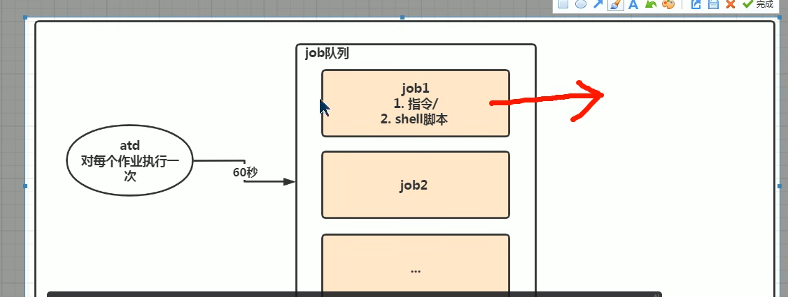

`at` 是一次性的，**执行完自动删除**。

```bash
sudo apt install at          # Ubuntu 默认没装 at（CentOS 默认自带）
sudo systemctl status atd     # 守护进程是 atd，每 60 秒检查一次作业队列

at 5pm + 2 days              # 回车后输入命令，Ctrl+D 结束输入（要按两次）
atq                          # 查看待执行队列
atrm 5                       # 删除 5 号任务
```

时间写法（知道这几种就够）：`04:00`、`now + 5 minutes`、`5pm tomorrow`、`04:00 2021-03-01`。

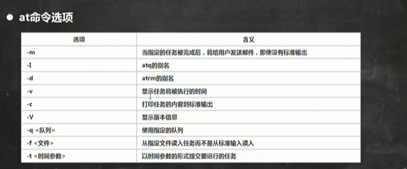

> 案例里的输出路径 `/root/date100.log` 在 Ubuntu 上要换成自己的家目录——
> **普通用户写不进 `/root`**，我当时在这里失败过一次。

### 周期任务 vs 一次性任务

| 工具 | 任务类型 | 守护进程 | 典型场景 |
|---|---|---|---|
| `crontab` | 周期性 | `cron` | 每天凌晨 2 点备份、每 5 分钟监控 |
| `at` | 一次性 | `atd`（60s 检查队列） | "明天下午 5 点执行一次" |

---

## 11. 磁盘分区与挂载

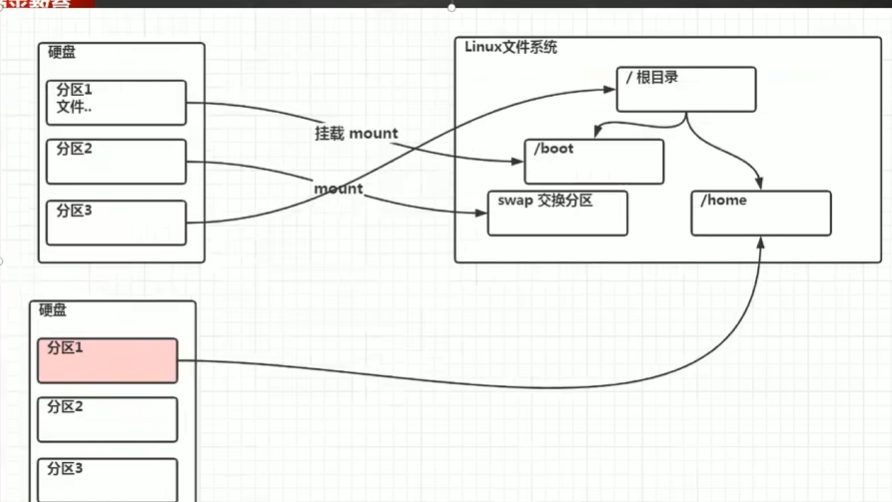

Linux 只有一个根目录，分区是通过**挂载**挂到某个目录上的——不是 Windows 的 C: D: 盘概念。

```bash
lsblk -f          # 查看所有设备与挂载情况（含 UUID 和文件系统类型）
```

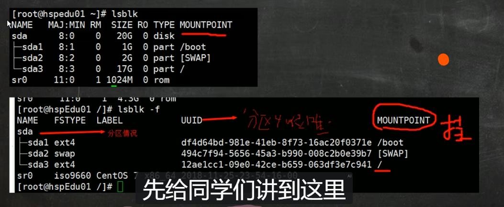

> **设备命名**：教程讲的 IDE（`hda`）/ SCSI（`sda`）已经过时。
> 现在常见的是 SATA/SCSI 的 `sda`、云主机的 `vda`、NVMe 的 `nvme0n1`。
> 我虚拟机里加的第二块盘是 `/dev/sdb`。

### 加一块硬盘的完整五步（我在 VMware 里做过）

**步骤 1**：VMware 设置 → 添加硬盘 → 重启

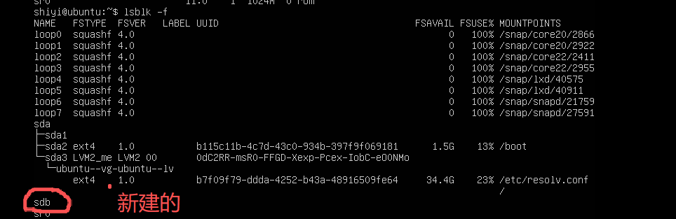

**步骤 2**：分区

```bash
sudo fdisk /dev/sdb      # n 新增 / p 主分区 / w 写入并退出（q 是不保存退出）
sudo fdisk -l             # 小写 -l，查看分区结果
```

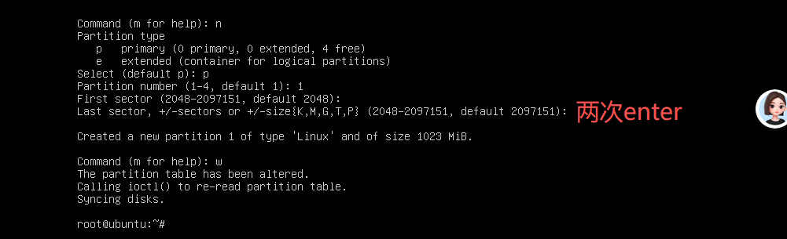

**步骤 3**：格式化

```bash
sudo mkfs -t ext4 /dev/sdb1
```

**步骤 4**：临时挂载（**重启后失效**）

```bash
sudo mkdir /newdisk
sudo mount /dev/sdb1 /newdisk
sudo umount /dev/sdb1        # 或 umount /newdisk
```

**步骤 5**：永久挂载（写 `/etc/fstab`）

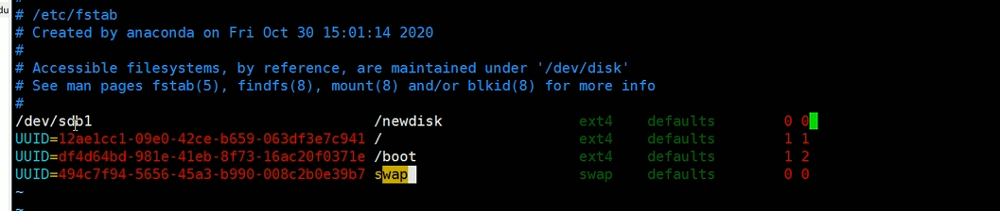

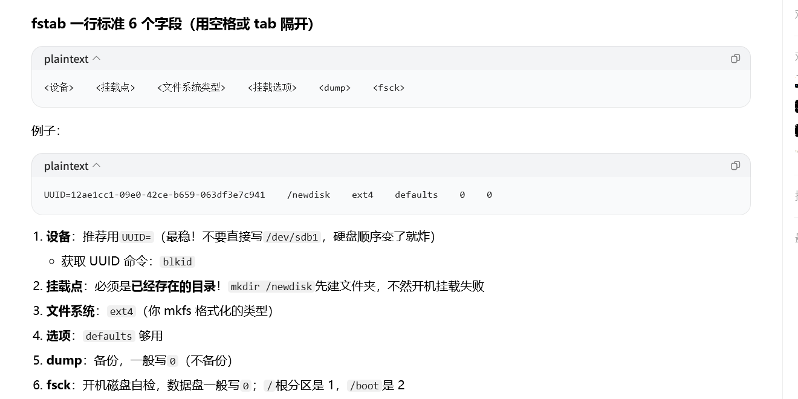

```bash
sudo mkdir /newdisk
sudo blkid /dev/sdb1         # 拿 UUID，比 /dev/sdb1 稳（设备名可能变）
sudo vim /etc/fstab
```

在 `/etc/fstab` 末尾加一行：

```text
UUID=dedd2113-5945-4336-9615-c60eb5651b09    /newdisk    ext4    defaults    0    0
```

（`UUID=` 后面那串就是我本机 `/dev/sdb1` 的 UUID，用 `blkid` 查出来粘进去的）

```bash
sudo mount -a                # 测试配置有没有写错
```

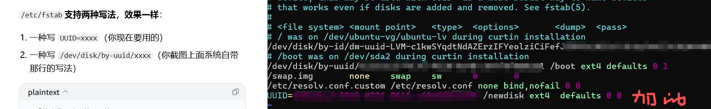

> ⚠️ **`mount -a` 没报错才算通过。报错就千万别重启**——fstab 写错会开不了机。
> 这是我做的每一步都带验证的原因：改 `/etc` 下的关键配置前，先备份、再测试、最后才重启。

**面试能讲的一句**

> 加盘五步：分区 `fdisk` → 格式化 `mkfs` → `mkdir` → `mount` 临时挂载 → 写 `/etc/fstab` 永久挂载。
> fstab 里用 **UUID 而不是设备名**，因为 `/dev/sdb` 这种名字在重启后可能变；
> 改完必须 `mount -a` 验一遍，不报错才能重启。

---

## 12. 磁盘使用查询：df / du

```bash
df -h                              # 看整个系统的磁盘使用率（分区视角）
du -h --max-depth=1 /opt           # 看指定目录下各子目录占多大（目录视角）
du -hac --max-depth=1 /opt          # -a 含文件、-c 最后加汇总值
```

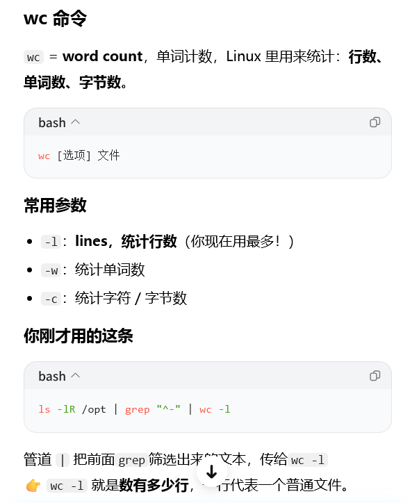

> **`df` 看还剩多少，`du` 看谁占的多**。
> "磁盘满了"的排查顺序：`df -h` 确认哪个分区满 → `du -h --max-depth=1` 逐层往下找大目录。

### 常用统计组合

```bash
ls -l  /opt | grep "^-" | wc -l      # /opt 下文件的个数
ls -l  /opt | grep "^d" | wc -l      # /opt 下目录的个数
ls -lR /opt | grep "^-" | wc -l       # 含子目录里的文件数
ls -lR /opt | grep "^d" | wc -l       # 含子目录里的目录数
tree /home/                          # 树状显示（没装就 sudo apt install tree）
```

> 装软件一律用 `apt`，教程里的 `yum install` 是 CentOS 的，Ubuntu 上没有。

---

## 附：本笔记的统一规则

1. 正文只记**我在 Ubuntu 上亲手执行过的命令**；CentOS / 教程内容一律压成「> 对照标注」一行。
2. **纯查询类、输出一眼看明白的命令不贴输出**——记命令和用法即可；
   需要解读的输出（权限位、`lsblk`、fstab）才贴。
3. 需要 root 权限的命令统一写 `sudo`，不直接切 root 操作。
4. 每节末尾留一句**面试能讲的话**——笔记的目的是攒讲得出来的东西，不是攒命令清单。
5. 动 `/etc` 下的配置（`fstab`、`sudoers`）、改防火墙、卸载软件之前：**先备份 / 先拍快照**，改完立刻验证。
