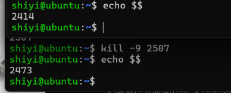
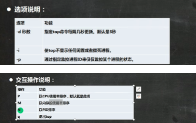
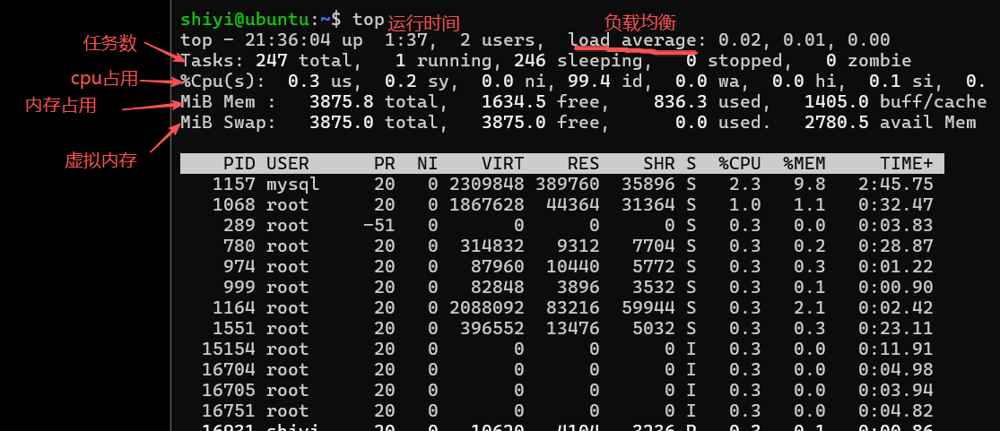
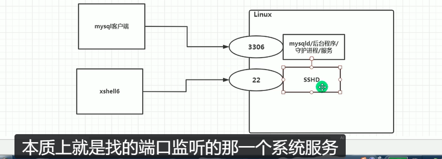
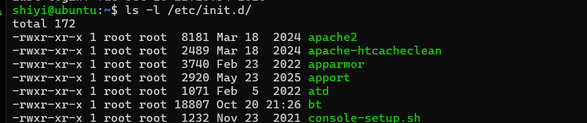
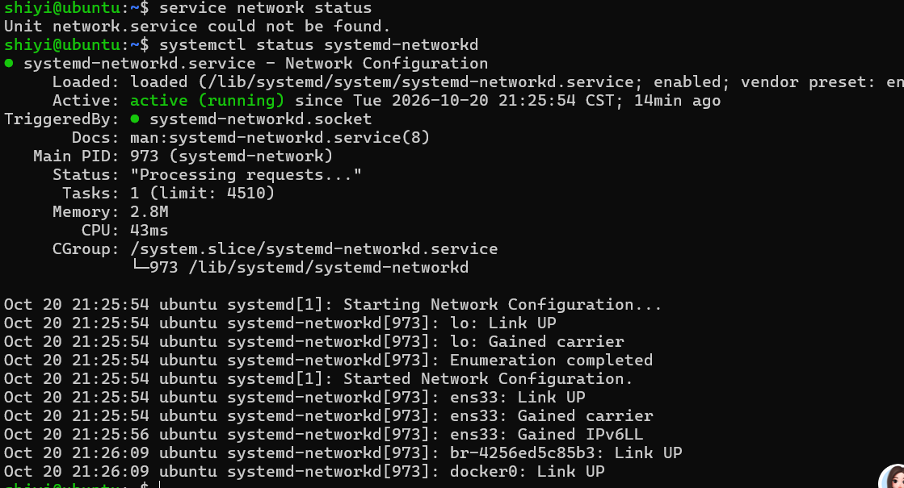
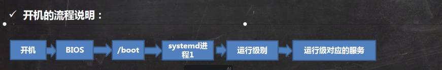
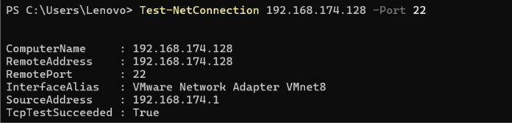
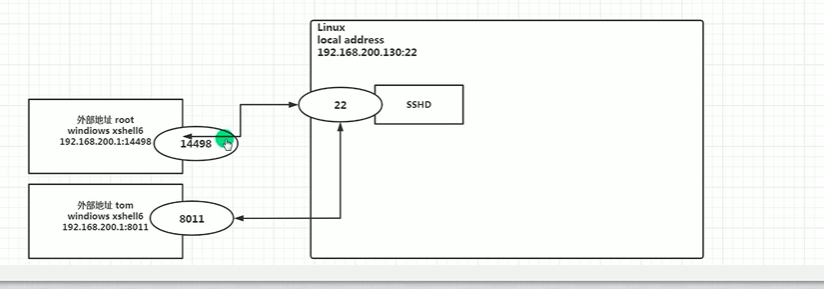

# week03 网络与进程服务管理

> **我的环境**：Ubuntu Server（VMware 虚拟机，NAT 模式，IP `192.168.174.128`）
> 另一台：Kali（VMware，同为 Debian 家族，命令通用）
> 发行版/内核：Ubuntu 22.04.5 LTS / 5.15.0-198-generic
>
> **关于教程**：主教程为 CentOS 7 环境（韩顺平）。CentOS 7 已于 **2024-06-30 EOL**，
> 官方 yum 源已下线，照抄 `yum install` 会报 `Could not resolve host`。
> 因此本笔记**正文只保留我在 Ubuntu 上亲手执行过的命令**，
> CentOS 内容一律降级为「对照标注」一行——这是本笔记的统一规则。
>
> 文中配图均为本人学习过程中自己截的图（含自己敲命令的终端输出）。

## 目录

- [1. 网络配置：NAT 与桥接](#1-网络配置nat-与桥接)
- [2. 实战：桥接静态 → NAT DHCP（含回滚）](#2-实战桥接静态--nat-dhcp含回滚)
- [3. 查看与测试网络](#3-查看与测试网络)
- [4. 主机名、hosts 与 DNS 解析](#4-主机名hosts-与-dns-解析)
- [5. 进程管理：ps / pstree / pgrep](#5-进程管理ps--pstree--pgrep)
- [6. 前后台与会话保持](#6-前后台与会话保持)
- [7. 终止进程：kill / killall / pkill](#7-终止进程kill--killall--pkill)
- [8. top 动态监控](#8-top-动态监控)
- [9. 服务管理：service → systemctl](#9-服务管理service--systemctl)
- [10. 启动目标：runlevel → systemd target](#10-启动目标runlevel--systemd-target)
- [11. 防火墙：ufw（含 firewalld 对照）](#11-防火墙ufw含-firewalld-对照)
- [12. 监控网络连接：ss（含 netstat 对照）](#12-监控网络连接ss含-netstat-对照)
- [13. 软件包管理：dpkg / apt（含 rpm / yum 对照）](#13-软件包管理dpkg--apt含-rpm--yum-对照)

---

## 1. 网络配置：NAT 与桥接

**先纠正一个容易说错的点：NAT 和桥接是两种模式，不存在「NAT 桥接模式」。**


*绿色路径：虚拟机为什么能 ping 通百度*

| | NAT（vmnet8） | 桥接 |
|---|---|---|
| 虚拟机 IP 网段 | vmnet8 虚拟网段（我的：`192.168.174.0/24`） | 与物理局域网同段（如 `192.168.1.0/24`） |
| 上网方式 | 主机做地址转换，虚拟机跟着主机走 | 虚拟机自己拿局域网 IP，需自行通过校园网认证 |
| 主机 ↔ 虚拟机 | 双向可通 | 双向可通 |
| 局域网其他设备访问虚拟机 | ❌ 访问不到（**这就是隔离，靶场要的就是它**） | ✅ 能访问（**等于把靶场挂在校园网上，危险**） |
| 适用场景 | **打靶场、日常练习（我的选择）** | 需要在局域网内提供服务时 |


> 补充：桥接时虚拟机 IP 的网关、DNS 必须与所在局域网一致，否则上不了外网；
> 很多校园网（锐捷 / Dr.com）要求每台设备单独认证，桥接的虚拟机会卡在这一步。

## 2. 实战：桥接静态 → NAT DHCP（含回滚）

**这是我亲手做的一次完整网络改造，也是本笔记里最有价值的一节。**

背景：Ubuntu Server 原本是桥接 + 静态 IP（`192.168.1.200/24`，网关 `192.168.1.1`），
为了把靶场隔离出校园网，改为 NAT + DHCP。

```bash
# ① 排查现状：netplan 配置文件权限是 root 600，普通用户 cat 会 Permission denied
ls -l /etc/netplan/
sudo cat /etc/netplan/01-static.yaml
# 结论：存在 01-static.yaml（静态，编号最大 → 覆盖其他文件，正在生效）
#       另有 00-install-config.yaml / 00-install-config_yaml（手滑存出的重复文件，均为 dhcp4: true）

# ② 备份（动网络配置前必做）
sudo cp -r /etc/netplan ~/netplan.bak-20261020

# ③ 移出静态配置（mv 不是 rm，随时可还原）
sudo mv /etc/netplan/01-static.yaml ~/01-static.yaml.bak

# ④ 应用 + 修权限（netplan 要求配置文件 600）
sudo chmod 600 /etc/netplan/*.yaml
sudo netplan apply

# ⑤ 关虚拟机 → VMware：设置 → 网络适配器 → NAT → 开机

# ⑥ 验证
ip addr show ens33     # → 192.168.174.128/24（dynamic，DHCP 分配）
ip route               # → default via 192.168.174.2
ping -c 4 baidu.com    # → 4 received, 0% packet loss
```

**回滚方案（一步还原）**

```bash
sudo mv ~/01-static.yaml.bak /etc/netplan/01-static.yaml && sudo netplan apply
```

**知识点**

- netplan 按文件名**编号顺序合并，大号覆盖小号**——`01-` 会盖住 `00-`。
- 静态 IP 的网段必须跟当前网络模式匹配。**旧配置里 `192.168.1.1` 是桥接网段的网关，
  在 NAT 下直接挪回来必然断网**；要在 NAT 下配静态，网关得用 `192.168.174.2`，
  且地址避开 DHCP 池（`128–254`），取 `.3–.127`。
- 改前备份、改后验证，是我给自己定的铁律。

> 教程环境用的是 `vi /etc/sysconfig/network-scripts/ifcfg-ens33` + `service network restart`，
> 这是 CentOS 的路径和命令，Ubuntu 上没有；Ubuntu 用 netplan + `netplan apply`。


## 3. 查看与测试网络

```bash
ip addr          # Ubuntu 查本机 IP（推荐）
ip route         # 查网关
ip -s link       # 查网卡收发包统计
```

> 教程用的是 `ifconfig`，它属于 net-tools 包，**新版 Ubuntu Server 默认没装**。
> 现代写法是 `ip` 命令族（ip addr / ip link / ip route），我全程用 `ip`。

```bash
ping -c 4 192.168.174.128   # 测内网连通（我打 Ubuntu 上的靶场前先做这步）
ping -c 4 baidu.com          # 测出网 + DNS 是否正常
```

Windows 主机侧查 vmnet8：`ipconfig`。

## 4. 主机名、hosts 与 DNS 解析

```bash
hostname                    # 查主机名
sudo hostnamectl set-hostname 新名字    # 改主机名（即时生效，无需重启）
cat /etc/hosts              # 本地 IP ↔ 主机名映射
```

> 教程写的是 `vim /etc/hostname` 后重启生效；Ubuntu 有 `hostnamectl`，改完立刻生效。

**解析顺序（面试常被问）**

1. 浏览器缓存 → 2. 操作系统 DNS 解析器缓存 → 3. hosts 文件 → 4. 外部 DNS 服务器


**Linux 侧排查 DNS（教程没有，但必会）**

```bash
resolvectl status           # 看当前 DNS 服务器（systemd-resolved）
cat /etc/resolv.conf        # 看实际生效的 DNS
dig baidu.com               # 手工解析，看是否被劫持/超时（需 apt install dnsutils）
```

> Windows 侧对应：`ipconfig /displaydns`（看缓存）、`ipconfig /flushdns`（清缓存）。


## 5. 进程管理：ps / pstree / pgrep

进程 = 执行中的程序，每个进程有唯一 PID。系统服务以后台方式常驻，直到关机。


```bash
ps aux | grep ssh | head     # 常用：查某类进程
ps -ef                       # 全格式，能看到 PPID（父进程）
pgrep -l sshd                # 只查 PID + 名字，比 ps|grep 干净
pstree -p                    # 树状看父子关系
```


| 字段 | 含义 |
|---|---|
| USER | 进程属主 |
| PID / PPID | 进程号 / **父进程号**（`ps -ef` 才有 PPID） |
| %CPU / %MEM | CPU、物理内存占用率 |
| VSZ / RSS | 虚拟内存 / **常驻物理内存**（单位 KB） |
| TTY | 终端（`?` 表示与终端无关的守护进程） |
| STAT | 进程状态 |
| START / TIME | 启动时间 / 累计占用 CPU 时间 |
| COMMAND | 启动命令与参数 |

**STAT 常见取值（这部分我核对过，教程表格有笔误）**

| 值 | 含义 |
|---|---|
| R | 正在运行 |
| S | 可中断睡眠（等事件） |
| **D** | **不可中断睡眠，通常在等 I/O**（强行 kill -9 也杀不掉，常见于卡死的磁盘/网络挂载） |
| T | 已停止 / 被跟踪 |
| Z | **僵尸进程**：已退出但父进程没回收，占着 PID |
| s / N / + | 会话首进程 / 低优先级 / 前台进程 |


> `ps -ef` 的 `C` 列是 CPU 调度优先级因子，面试不考，知道即可。

## 6. 前后台与会话保持

教程只讲了“前台/后台”的概念，没给命令。这几条是运维高频：

```bash
ping baidu.com > /tmp/p.log &   # 末尾 &：丢到后台跑
jobs                            # 看当前 shell 的后台任务
fg %1                           # 拉回前台
bg %1                            # 把暂停的任务放到后台继续
Ctrl+Z                           # 把当前前台任务暂停
nohup 命令 &                     # 退出终端也不中断（输出落 nohup.out）
```

> 想长期跑、且断线不丢，用 `tmux`：`tmux` 进入，`Ctrl+B` 后按 `%` 分屏、
> 按 `o` 切换、按 `d` 脱离，回来 `tmux a` 接上。**我打靶场/跑长任务就用它。**

## 7. 终止进程：kill / killall / pkill

### 怎么造出「两个终端」（教程用分屏演示，我这里这样做）

- **主机开两个 SSH 窗口连同一台机**：一个跑进程，一个杀进程。这是真实运维形态。
- 备选：`tmux` 分屏（同一连接内搞定）。

### 练习靶子

教程用 gedit（图形程序）演示。我这里没有图形界面，
用**长驻进程**代替，知识点完全一样：

```bash
# 终端 A
ping baidu.com        # 一直刷屏、光标被占住 = 教程里"gedit 开着"
```

```bash
# 终端 B
pgrep -l ping         # 找 PID，如 3456
kill 3456             # TERM：礼貌退出 → 终端 A 显示 Terminated
kill -9 3456          # KILL：强杀 → 终端 A 显示 Killed
killall ping          # 按名字全杀
pkill ping            # 同上，支持正则
```

其他可用靶子：`sleep 600`、`tail -f /var/log/syslog`、`top`。

### 信号只记这三个

| 信号 | 命令 | 什么时候用 |
|---|---|---|
| TERM (15) | `kill <pid>` | **默认先用它**，进程能收尾 |
| KILL (9) | `kill -9 <pid>` | 杀不动才用，进程无法捕获也无法拒绝 |
| 按名字 | `killall` / `pkill` | 懒得查 PID 时 |

**顺序铁律：`pgrep` 确认 → `kill` → 不行才 `-9`**

### 我踩过的坑

1. **杀之前先 `echo $$`**——别把自己的当前 shell 杀了（新手最常犯）。
   `echo` 和 `$$` 之间必须有空格，写 `echo$$` 会被解析成不存在的命令 `echo2414`。

   

2. **教程「kill 掉 sshd 服务」的案例别跟着做**——我是 SSH 远程连进去的，
   杀它等于锯自己坐的树枝。要练服务操作用 `sudo systemctl restart ssh`。
3. 教程的 `sshd.service` 是 CentOS 命名，Ubuntu 服务名是 **`ssh`**。

### 面试能讲的一句

> `-9` 是 KILL 信号，进程无法捕获也无法拒绝，来不及落盘；
> 所以先 `kill`，杀不动再 `-9`，顺序反了可能丢数据。
> 另外 D 状态（等 I/O）的进程 `-9` 也杀不掉，得先解决底层 I/O 问题。

## 8. top 动态监控



```bash
top            # 默认 3 秒刷新
top -d 10      # 每 10 秒刷新
```

交互键（**区分大小写**）：`P` 按 CPU 排序、`M` 按内存排序、`N` 按 PID 排序、
`u` 再输用户名只看该用户、`k` 再输 PID 杀进程、`q` 退出。

**输出头部要看懂的三行**

- `load average: 0.05, 0.10, 0.08` —— 1/5/15 分钟平均负载，**等于 CPU 核数即为满负荷**
- `%Cpu(s)` —— us 用户态、sy 内核态、**id 空闲**、wa 等 I/O（**wa 高说明磁盘/网络拖后腿**）
- `KiB Mem` —— 看 available；`RES` 是进程真实占的物理内存



## 9. 服务管理：service → systemctl

服务（service）本质是**后台常驻、监听端口、等待请求**的进程，也叫守护进程（daemon）。
例：sshd、mysqld、防火墙。



> 老命令 `service 服务名 start|stop|restart|status` 在 CentOS 7 后已被 systemctl 取代，
> 其管理的脚本在 `/etc/init.d`（Ubuntu 上该目录基本为空）。**统一用 systemctl。**





### systemctl 管什么

- 单元文件在 `/lib/systemd/system/`、`/etc/systemd/system/`（不再是 `/etc/init.d`）
- **服务有两套独立状态，别混**：
  - 运行状态 `active (running)` / `inactive` / `failed` —— 现在活没活着
  - 自启状态 `enabled` / `disabled` —— 开机拉不拉

### 核心命令（对象用 ssh，都是我在 Server 上跑过的）

```bash
# 看状态
systemctl status ssh          # active (running) + enabled 才算正常
systemctl is-active ssh        # 只要一个词：active / inactive
systemctl is-enabled ssh       # 只要一个词：enabled / disabled

# 运行控制
sudo systemctl start ssh       # 启动
sudo systemctl stop ssh        # 停止
sudo systemctl restart ssh    # 重启（改完配置用这个）
sudo systemctl reload ssh     # 只重读配置，不断连接（服务支持才有）

# 自启控制
sudo systemctl enable ssh            # 开机自启（现在不启动）
sudo systemctl enable --now ssh      # 自启 + 立刻启动，一步到位
sudo systemctl disable ssh           # 取消自启（现在不停）

# 查看所有服务（等价老的 chkconfig --list）
systemctl list-unit-files --type=service | grep ssh
```

### 临时 vs 永久

| 操作 | 生效范围 | 重启后 |
|---|---|---|
| start / stop | **临时**（管现在） | 失效，回到自启状态 |
| enable / disable | **永久**（管开机） | 保持 |

### 三个易混点

1. **enable ≠ start**。enable 只管"开机拉不拉"，不管现在。一步到位用 `enable --now`。
2. **enable 和 target 无关**。target 管开机进哪种模式，enable 管单个服务，两个维度。
3. **Ubuntu 桌面版才有 NetworkManager，Server 版没有**（Server 用 systemd-networkd + netplan）。
   教程拿 NetworkManager 演示是因为它装的是桌面版；我在 Server 上练，对象换成 ssh。
   看到 `Unit xxx.service could not be found` → 先怀疑**这个服务在这台机上根本不存在**。

### 实验记录（本机真实执行）

```bash
systemctl status ssh                                   # → active (running)、enabled
sudo systemctl disable ssh && systemctl is-enabled ssh      # → disabled
sudo systemctl enable --now ssh && systemctl is-enabled ssh  # → enabled
sudo systemctl stop ssh        # 当前 SSH 窗口还活着，但新连接被拒
sudo systemctl start ssh       # 恢复
```

> 关键理解：**`stop` 断的是新连接，已建立的会话不受影响**——
> 所以验证 ssh 状态不能靠"我这个窗口还能敲命令"，要看 `is-active` 或端口监听。

> 教程里 CentOS 的 `setup` 命令（图形化勾选自启服务）Ubuntu 上没有，
> 对应动作是 `systemctl enable/disable`。

## 10. 启动目标：runlevel → systemd target

老系统用运行级别 0–6 决定开机进图形还是命令行，systemd 改用 target，本质一样。

| 老 runlevel | 新 target | 含义 |
|---|---|---|
| 2（Debian 系）/ 3（RHEL 系） | **multi-user.target** | 纯命令行（服务器） |
| 5 | graphical.target | 图形桌面 |
| 0 / 6 | poweroff.target / reboot.target | 关机 / 重启 |

```bash
systemctl get-default                          # → multi-user.target（证明我这台没装图形）
sudo systemctl set-default multi-user.target  # 设为默认进命令行
```

> 其余 runlevel（1 单用户、4 保留等）是历史包袱，不记。
> CentOS 的 `chkconfig --list` / `chkconfig 服务名 on` 对应上面的 `is-enabled` / `enable`。



### 面试能讲的一句

> 生产服务器应保持 `multi-user.target`——不装图形既省资源，也是缩小攻击面。

## 11. 防火墙：ufw（含 firewalld 对照）

```bash
# ① 起点确认：SSH 必须是活的（后面万一锁门还能开得回来）
systemctl is-active ssh        # → active

# ② 看现状
sudo ufw status                # → Status: inactive（Server 默认关）

# ③ 关键顺序：先放行 SSH，再开防火墙
sudo ufw allow ssh             # → Rules updated
sudo ufw enable                # 输入 y → Firewall is active

# ④ 看结果
sudo ufw status                # → 22/tcp ALLOW，Status: active

# ⑤ 练习开/关其他端口
sudo ufw allow 111/tcp
sudo ufw delete allow 111/tcp

# ⑥ 验证端口在听
ss -tlnp | grep :22            # → 0.0.0.0:22 LISTEN
```

**安全铁律：`enable` 之前先 `allow ssh`。** 顺序反了就把自己锁在门外——
好在我这是虚拟机，VMware 控制台永远能进，物理机没这条后路。

主机侧（Windows PowerShell）验证：
`Test-NetConnection 192.168.174.128 -Port 22` → `TcpTestSucceeded : True` 即通。



> 结束时**不要把 ufw 关回去**——服务器开着防火墙才是正常状态，保持 active + 22 放行。

### firewalld ↔ ufw 对照（遇到 CentOS 机器时查这张，不用背）

| 功能 | CentOS（firewalld） | Ubuntu（ufw） |
|---|---|---|
| 开端口 | `firewall-cmd --permanent --add-port=111/tcp` | `sudo ufw allow 111/tcp` |
| 关端口 | `firewall-cmd --permanent --remove-port=111/tcp` | `sudo ufw delete allow 111/tcp` |
| 生效 | `firewall-cmd --reload`（要手动重载） | **立即生效，不用 reload** |
| 查端口 | `firewall-cmd --query-port=111/tcp` | `sudo ufw status` |

> firewalld 的"永久配置与运行配置分离"在运维上是优点（改了不立刻生效，可反悔）；
> ufw 是改完即生效。两种设计各有道理，用哪边都能讲出理由。

## 12. 监控网络连接：ss（含 netstat 对照）

```bash
ss -tlnp              # 查本机监听的 TCP 端口 + 对应进程（最常用）
ss -tlnp | grep :22   # 只查 22
ss -tan               # 查所有连接（含 established / time_wait）
```

**连接状态**：`LISTEN` 监听（等别人来连）、`ESTABLISHED` 已建立连接、
`TIME_WAIT` 连接刚关闭、处于等待（四次挥手后主动关闭方会停留一段时间）。



> 教程用的是 `netstat -anp | grep sshd`。`netstat` 属 net-tools，**新 Ubuntu 默认没装**，
> 现代替代是 `ss`（更快、语法更短）。要不要装 net-tools 看环境，我统一用 `ss`。
> 另外注意：**进程名叫 sshd，但服务单元名是 ssh**，`systemctl` 要用后者。

## 13. 软件包管理：dpkg / apt（含 rpm / yum 对照）

Ubuntu 和 Kali 都是 Debian 家族，用 dpkg + apt；**没有 rpm / yum**。

| 功能 | CentOS（教程） | Ubuntu / Kali（我的机器） |
|---|---|---|
| 查已装列表 | `rpm -qa \| grep xx` | `dpkg -l \| grep xx` |
| 查是否安装 | `rpm -q firefox` | `dpkg -l firefox`（或 `dpkg -s`） |
| 查软件包信息 | `rpm -qi firefox` | `apt show firefox` |
| 查包装了哪些文件 | `rpm -ql firefox` | `dpkg -L firefox` |
| **查文件属于哪个包** | `rpm -qf /etc/passwd` | `dpkg -S /etc/passwd` |
| 卸载 | `rpm -e firefox` | `sudo apt remove firefox` |
| 连配置文件一起删 | — | `sudo apt purge firefox` |
| 强制卸载 | `rpm -e --nodeps` | （不需要，apt 不会留破依赖） |
| 装本地包 | `rpm -ivh xxx.rpm` | `sudo dpkg -i xxx.deb` |
| 联网搜索 | `yum list \| grep xx` | `apt search 关键词` |
| 联网安装 | `yum install xxx` | `sudo apt install xxx` |
| 联网卸载 | `yum remove xxx` | `sudo apt remove xxx` |

### 本机执行记录

以下五条均已在 Ubuntu Server 上跑通，**不逐条贴输出**——它们都是查询类命令，输出本身没有信息量，记命令和用法即可。

```bash
dpkg -l | grep ssh                 # ① 确认 openssh-server 已装
apt show openssh-server            # ② 看版本、大小、依赖
dpkg -L openssh-server | head -20  # ③ 看它把文件装到了哪（sshd 在 /usr/sbin，配置在 /etc/ssh）
dpkg -S /etc/passwd                # ④ 反查：这个文件属于哪个包 → passwd
sudo apt install -y tree && tree --version && sudo apt remove -y tree   # ⑤ 装→验证→卸，走一遍闭环
```

> `③ dpkg -L` 原始输出 40 多行，`| head -20` 截断即可。
> **选记原则**：贴输出是为了证明"我看懂了输出"；纯查询类、输出一眼看明白的，不贴。


### 坑与要点

1. **`apt update` ≠ 升级**，它只刷新软件索引；升级要再跑 `apt upgrade`。
   不 update 直接 install，容易装到旧版或报 404。
2. **`.rpm` 和 `.deb` 是两种包格式，不能互换**；架构名 Debian 系叫 `amd64`，不是 `x86_64`。
3. `dpkg -S <文件路径>` 是安全排查的常用招：
   发现可疑文件 → 查它属于哪个包 → 判断是不是被人替换过。
4. **Kali 是滚动发行版**，别随手 `apt full-upgrade`（可能把靶场环境搞乱），升级前先拍快照。
5. 想看"这个包到底动了我系统哪些地方"，`dpkg -L`；反过来，看到可疑文件用 `dpkg -S` 查主人。

### 面试能讲的一句

> Debian 系（Ubuntu / Kali）用 dpkg + apt，RedHat 系（CentOS）用 rpm + yum/dnf，
> 两套思想一致：本地数据库记录已装软件，联网仓库自动解依赖。
> 日常用 apt；`dpkg -L` 看包的文件分布、`dpkg -S` 反查文件归属——后者在安全排查里常用。

---

## 附：本笔记的统一规则

1. 正文只记**我在 Ubuntu 上亲手执行过、有真实输出**的命令。
2. CentOS / 教程内容一律压成「> 对照标注」一行，不占正文。
3. 每节末尾留一句**面试能讲的话**——笔记的目的是攒讲得出来的东西，不是攒命令清单。
4. 动 `/etc` 配置、卸载软件、改防火墙之前：**先备份 / 先拍快照**。
