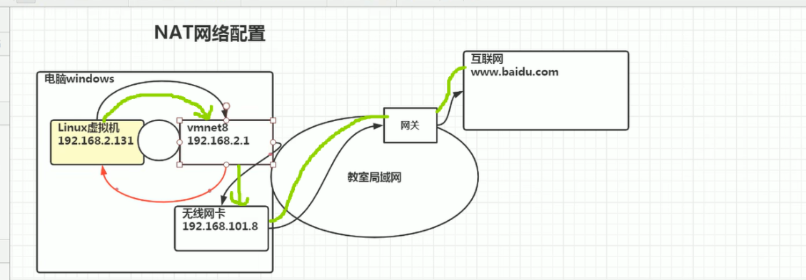
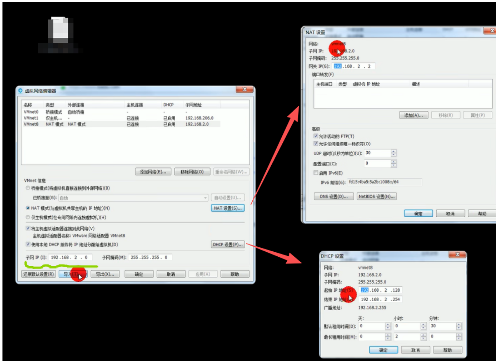
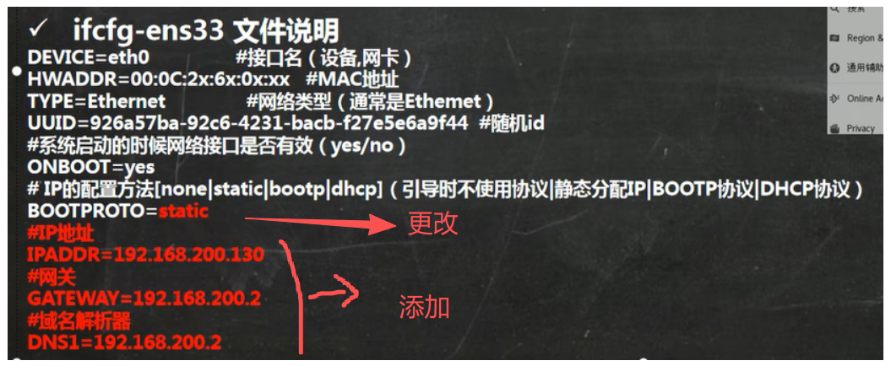
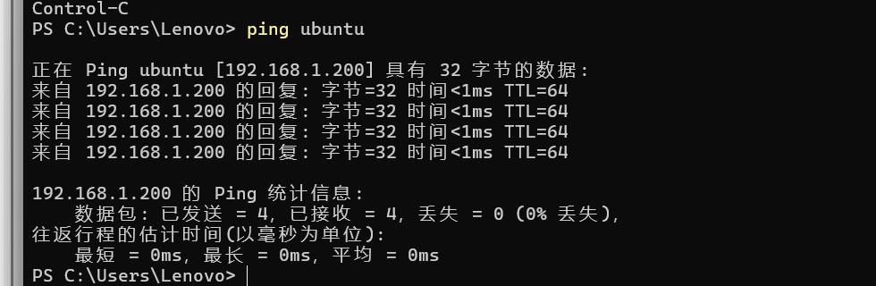
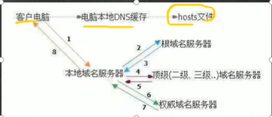
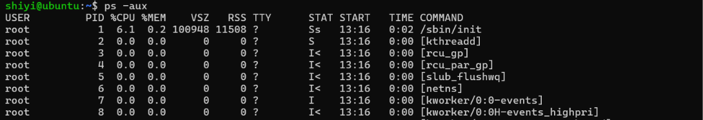
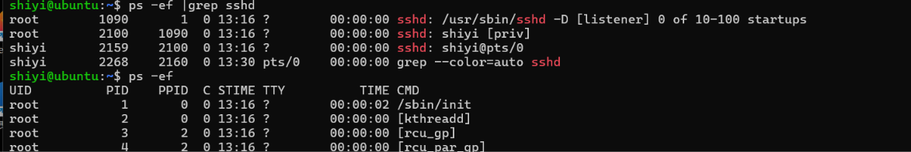

## 网络配置

### NAT网络原理图

**NAT桥接模式**



绿色：虚拟机为什么能ping通百度

linux虚拟机：ifconfig  （自动分配/固定ip）

vmnet8：本机ipconfig    

无线网卡：本机

#### **补充**

- NAT 模式（对应 vmnet8）：vmnet8 是 NAT 专用虚拟网卡，虚拟机通过它做地址转换上网，虚拟机 IP 必须和 vmnet8 同网段。**默认虚拟机可以访问主机；主机访问虚拟机可能被 Windows 防火墙拦截，需要放开防火墙**。
- 桥接模式：虚拟机 IP（192.168.1.x）的网关、DNS 需要和教室局域网保持一致，否则无法访问外网。**配置正确后，主机和虚拟机可以双向互相访问**。



### 网络配置指令

#### 查看网络配置

- 查看windows环境中的VMnet8网络配置

  ipconfig（终端）或 控制面板

- 查看linux的网络配置ifconfig   **if不是ip**

#### ping测试主机之间网络连通性

ping 192.168.1.xxx     ping  www.baidu.com

### 网络配置

1. 自动获取
   说明:登陆后,通过界面的来设置自动获取ip,特点:linux启动后会自动获取IP,缺点是每次自动获取的
   ip地址可能不一样。

2. 指定ip
   直接修改配置文件来指定IP,并可以连接到外网(程序员推荐)
   编辑 vi /etc/sysconfig/network-scripts/ifcfg-ens33
   
   (域名劫持攻击)
   
   要求:将ip地址配置的静态的,比如:ip地址为192.168.200.130
   
   

而且需要在网络编辑器那改网关NAT和子网IP

√ 重启网络服务或者重启系统生效

service network restart , reboot

### 设置主机名和hosts映射

##### 设置主机名

1. 为了方便记忆,可以给linux系统设置主机名,也可以根据需要修改主机名
2. 指令hostname     查看主机名
3. vim   /etc/hostname 修改主机名
4. 修改后,重启生效

#####  设置hosts映射

思考:如何通过 主机名能够找到(比如ping)某个linux系统?

######  windows

**管理员方式运行记事本，然后改，才有效**

在C:\Windows\System32\drivers\etc\hosts文件指定即可
案例:192.168.200.130 hspedu100 （linux-ip  主机名）

然后  ping 主机名



######  linux

在/etc/hosts 文件 指定（sudo  -i）
案例:192.168.200.1 ThinkPad-PC

##### 主机名解析过程分析(Hosts、DNS)

###### Hosts是什么

一个文本文件,用来记录IP和Hostname(主机名)的映射关系

######  DNS

1. DNS,就是Domain Name System的缩写,翻译过来就是域名系统
2. 是互联网上作为域名和IP地址相互映射的一个分布式数据库

###### 应用实例:用户在浏览器输入了www.baidu.com

1. 浏览器先检查**浏览器缓存**中有没有该域名解析IP地址,有就先调用IP完成解析;

   如果没有,就检查**DNS解析器缓存**,如果有直接
   返回IP完成解析。这两个缓存,可以理解为 本地解析器缓存

2. 一般来说,当电脑第一次成功访问某一网站后,在一定时间内,浏
   览器或操作系统会缓存他的IP地址(DNS解析记录).如在cmd窗
   口中输入
   ipconfig /displaydns      //DNS域名解析缓存
   ipconfig /flushdns        //手动清理dns缓存

3. 如果**本地解析器缓存**没有找到对应映射,检查系统中**hosts文件**中
     有没有配置对应的域名IP映射,如果有,则完成解析并返回。

4. 如果 本地DNS解析器缓存 和hosts文件 中均没有找到对应的IP,
     则到**域名服务DNS**进行解析域



## 进程管理

### 基本介绍

1. 在LINUX中,每个执行的程序都称为一个进程。每一个进程都分配一个ID号(pid,进程号)。
  =>windows => linux

2. 每个进程都可能以两种方式存在的。前台与后台,所谓前台进程就是用户目前的屏幕上可以进行操作的。后台进程则是实际在操作,但由于屏幕上无法看到的进程,通常使用后台方式执行。
3. 一般系统的服务都是以后台进程的方式存在,而且都会常驻在系统中。直到关机才才结束。

### ps指令详解

#### 显示系统执行的进程


```bash
 ps -aux |grep xxx |more  #常用
```



##### ps详解、

- USER:用户名称
- PID:进程号
- %CPU:进程占用CPU的百分比
- %MEM:进程占用物理内存的百分比
-  VSZ:进程占用的虚拟内存大小(单位:KB)
- RSS:进程占用的物理内存大小(单位:KB)
-  RTT:终端名称,缩写.
- STAT:进程状态,其中S-睡眠,s-表示该进程是会话的先导进程,N-表示进程拥有比普通优先级更低的优先级,R-正在运行,D-短期等待,Z-僵死进程,T-被跟踪或者被停止等等
- STARTED:进程的启动时间
- TIME:CPU时间,即进程使用CPU的总时间
- COMMAND:启动进程所用的命令和参数,如果过长会被截断显示
  所用的命令和参数

##### 父子进程



- 要求:以全格式显示当前所有的进程,查看进程的父进程。
- ps-ef是以全格式显示当前所有的进程    -e显示所有进程。-f全格式
- ps -ef|grep xxx

- PPID:父进程ID
- C:CPU用于计算执行优先级的因子。数值越大,表明进程是CPU密集型运算,执行优先级会降低;数值越小,表明进程是I/O密集型运算,执行优先级会提高
-  STIME:进程启动的时间

### 终止进程kill和killall

若是某个进程执行一半需要停止时,或是已消了很大的系统资源时,此时可以考虑停止该进程。使用kill命令来完成此项任务。
● 基本语法
kill  [选项]  进程号           (功能描述:通过进程号杀死/终止进程)
killall 进程名称(功能描述:通过进程名称杀死进程,也支持通配符,这在系统因负载过大而变得很慢
时很有用)

- 常用选项

9:表示强迫进程立即停止

- 最佳实践

```bash
#案例1:踢掉某个非法登录用户kill 进程号
kill 11421
#案例2:终止远程登录服务sshd,在适当时候再次重启sshd服务
kill sshd  xxxx #(进程号)
/bin/systemctl start sshd.service
#案例3:终止多个gedit,演示 killall gedit

#案例4:强制杀掉一个终端
```


## 软件包管理

 
